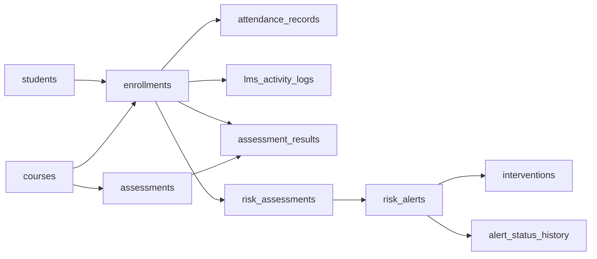

# SE-EWRS — Entity Relationship Diagram

**Student Engagement & Early Warning Risk System**
DBMS course project · Department of Mathematics
Mohammad Adnan · Lucky Dhall · Raja · Sumit

---

## 1. Full ER diagram

```mermaid
erDiagram
    DEPARTMENTS ||--o{ USERS : "employs"
    DEPARTMENTS ||--o{ STUDENTS : "admits"
    DEPARTMENTS ||--o{ COURSES : "offers"

    USERS ||--o{ COURSE_INSTRUCTORS : "teaches via"
    COURSES ||--o{ COURSE_INSTRUCTORS : "is taught by"

    STUDENTS ||--o{ ENROLLMENTS : "enrols in"
    COURSES ||--o{ ENROLLMENTS : "has enrolled"

    ENROLLMENTS ||--o{ ATTENDANCE_RECORDS : "attends sessions"
    ENROLLMENTS ||--o{ LMS_ACTIVITY_LOGS : "generates activity"
    ENROLLMENTS ||--o{ ASSESSMENT_RESULTS : "is graded in"
    ENROLLMENTS ||--o{ RISK_ASSESSMENTS : "is scored by"
    ENROLLMENTS ||--o{ RISK_ALERTS : "raises"
    ENROLLMENTS ||--o{ INTERVENTIONS : "receives"

    COURSES ||--o{ ASSESSMENTS : "sets"
    ASSESSMENTS ||--o{ ASSESSMENT_RESULTS : "is answered by"

    RISK_ASSESSMENTS |o--o{ RISK_ALERTS : "evidences"
    RISK_ALERTS ||--o{ ALERT_STATUS_HISTORY : "transitions through"
    RISK_ALERTS |o--o{ INTERVENTIONS : "prompts"

    USERS |o--o{ ATTENDANCE_RECORDS : "records"
    USERS |o--o{ ASSESSMENTS : "creates"
    USERS |o--o{ ASSESSMENT_RESULTS : "grades"
    USERS |o--o{ RISK_ALERTS : "is assigned"
    USERS |o--o{ ALERT_STATUS_HISTORY : "changes"
    USERS |o--o{ INTERVENTIONS : "advises on"
    USERS |o--o{ AUDIT_LOGS : "acts in"
    USERS |o--o{ SYSTEM_SETTINGS : "last updated"

    DEPARTMENTS {
        int dept_id PK
        varchar dept_code UK
        varchar dept_name UK
        datetime created_at
        datetime updated_at
    }

    USERS {
        int user_id PK
        varchar full_name
        varchar email UK
        varchar password_hash "Argon2id, never returned by the API"
        enum role "ADMIN INSTRUCTOR TA ADVISOR CHAIR"
        int dept_id FK
        varchar phone
        tinyint is_active
        datetime last_login_at
        datetime created_at
        datetime updated_at
    }

    STUDENTS {
        int student_pk PK
        varchar student_id UK "roll number"
        varchar full_name
        varchar email UK
        int dept_id FK
        tinyint semester "CHECK 1..12"
        smallint enrollment_year "CHECK 2000..2100"
        varchar phone
        tinyint is_active "soft delete"
        datetime created_at
        datetime updated_at
    }

    COURSES {
        int course_pk PK
        varchar course_code "UK with academic_term"
        varchar course_name
        int dept_id FK
        tinyint semester "CHECK 1..12"
        tinyint credits "CHECK 1..10"
        varchar academic_term "UK with course_code"
        smallint total_sessions
        tinyint is_active
        datetime created_at
        datetime updated_at
    }

    COURSE_INSTRUCTORS {
        int course_instructor_id PK
        int course_pk FK "UK with user_id"
        int user_id FK "UK with course_pk"
        enum role_in_course "PRIMARY CO_INSTRUCTOR TA"
        datetime assigned_at
    }

    ENROLLMENTS {
        int enrollment_id PK
        int student_pk FK "UK with course_pk"
        int course_pk FK "UK with student_pk"
        date enrolled_on
        enum status "ACTIVE DROPPED COMPLETED"
        datetime created_at
        datetime updated_at
    }

    ATTENDANCE_RECORDS {
        int attendance_id PK
        int enrollment_id FK "UK with session_date, session_no"
        date session_date "UK component"
        smallint session_no "UK component, CHECK >= 1"
        enum status "PRESENT ABSENT LATE EXCUSED"
        int recorded_by FK
        varchar remarks
        datetime created_at
    }

    LMS_ACTIVITY_LOGS {
        bigint activity_id PK
        int enrollment_id FK
        enum activity_type "LOGIN RESOURCE_VIEW FORUM_POST VIDEO_WATCH QUIZ_ATTEMPT ASSIGNMENT_SUBMIT"
        datetime activity_at
        int duration_minutes "CHECK NULL OR >= 0"
        varchar resource_ref
        datetime created_at
    }

    ASSESSMENTS {
        int assessment_id PK
        int course_pk FK "UK with title"
        varchar title "UK with course_pk"
        enum assessment_type "ASSIGNMENT QUIZ MIDTERM FINAL PROJECT LAB"
        decimal max_marks "CHECK > 0"
        decimal weight_percent "CHECK 0..100"
        datetime due_at
        int created_by FK
        datetime created_at
        datetime updated_at
    }

    ASSESSMENT_RESULTS {
        int result_id PK
        int assessment_id FK "UK with enrollment_id"
        int enrollment_id FK "UK with assessment_id"
        decimal marks_obtained "NULL = ungraded, CHECK >= 0"
        decimal percentage "derived by trigger"
        datetime submitted_at
        enum submission_status "ON_TIME LATE MISSING"
        tinyint attempt_no "CHECK >= 1"
        int graded_by FK
        datetime graded_at
        datetime created_at
        datetime updated_at
    }

    RISK_ASSESSMENTS {
        int risk_id PK
        int enrollment_id FK
        datetime calculated_at
        decimal attendance_percentage
        decimal avg_assessment_percentage
        decimal engagement_score
        decimal attendance_risk
        decimal academic_risk
        decimal engagement_risk
        decimal risk_score "CHECK NULL OR 0..100"
        enum risk_category "LOW MEDIUM HIGH INSUFFICIENT_DATA"
        enum data_completeness "COMPLETE PARTIAL INSUFFICIENT"
        varchar missing_data_reasons
        varchar contributing_factors
        smallint sessions_held
        smallint sessions_attended
        smallint late_submissions
        smallint missing_submissions
        smallint graded_assessments
        smallint login_count_30d
        smallint days_since_last_activity
        date last_assessment_date
        varchar model_version
    }

    RISK_ALERTS {
        int alert_id PK
        int enrollment_id FK "UK with active_flag"
        int risk_id FK
        decimal risk_score "CHECK 0..100"
        enum risk_category "MEDIUM HIGH"
        varchar triggering_factors
        enum status "NEW ACKNOWLEDGED IN_PROGRESS RESOLVED"
        int assigned_to FK
        datetime acknowledged_at
        datetime resolved_at
        datetime created_at
        datetime updated_at
        tinyint active_flag "GENERATED: 1 while open, NULL once resolved"
    }

    ALERT_STATUS_HISTORY {
        int history_id PK
        int alert_id FK
        enum old_status
        enum new_status
        int changed_by FK
        varchar note
        datetime changed_at
    }

    INTERVENTIONS {
        int intervention_id PK
        int enrollment_id FK
        int alert_id FK "must share the enrolment"
        enum intervention_type "COUNSELING TUTORING_REFERRAL ASSIGNMENT_SUPPORT ATTENDANCE_FOLLOWUP ACADEMIC_ADVISING PARENT_CONTACT"
        int assigned_advisor_id FK
        date contact_date
        text notes
        text action_plan
        date follow_up_date "CHECK NULL OR >= contact_date"
        enum outcome "PENDING IMPROVED NO_CHANGE DECLINED ESCALATED"
        enum resolution_status "OPEN IN_PROGRESS CLOSED"
        int created_by FK
        datetime created_at
        datetime updated_at
    }

    SYSTEM_SETTINGS {
        varchar setting_key PK
        varchar setting_value
        enum value_type "INT FLOAT STRING BOOL"
        varchar description
        int updated_by FK
        datetime updated_at
    }

    AUDIT_LOGS {
        bigint audit_id PK
        int user_id FK
        varchar action
        varchar entity_type
        varchar entity_id
        text old_values
        text new_values
        varchar ip_address
        datetime created_at
    }
```



---

## 2. Simplified view — the engagement spine

The diagram above is complete but dense. The shape that matters is this:
**every engagement fact hangs off `enrollments`**, never off `students`
directly.



That single decision is what makes it structurally impossible to record
attendance, an LMS event or a grade for a student who is not enrolled in
the course concerned. The alternative — `(student_pk, course_pk)` columns
on each fact table — would permit exactly that, and would duplicate the
pair on every one of several thousand rows.

---

## 3. Cardinality summary

| Relationship | Cardinality | Enforced by |
|---|---|---|
| departments → students | 1 : N | `fk_students_dept` (`ON DELETE RESTRICT`) |
| departments → courses | 1 : N | `fk_courses_dept` (`ON DELETE RESTRICT`) |
| departments → users | 1 : N (optional) | `fk_users_dept` (`ON DELETE SET NULL`) |
| students ↔ courses | M : N via `enrollments` | `uq_enrollment_student_course` |
| courses ↔ users | M : N via `course_instructors` | `uq_course_instructor` |
| enrollments → attendance_records | 1 : N | `uq_attendance_session` prevents duplicate sessions |
| enrollments → lms_activity_logs | 1 : N | — (an enrolment may have many events) |
| courses → assessments | 1 : N | `uq_assessment_course_title` |
| assessments ↔ enrollments | M : N via `assessment_results` | `uq_result_assessment_enrollment` |
| enrollments → risk_assessments | 1 : N (history) | append-only; latest row picked by `ROW_NUMBER()` |
| enrollments → risk_alerts | 1 : N total, **1 : 1 open** | `uq_alert_one_active_per_enrollment` |
| risk_assessments → risk_alerts | 1 : N (optional) | `fk_alert_risk` (`ON DELETE SET NULL`) |
| risk_alerts → alert_status_history | 1 : N | `fk_ash_alert` (`ON DELETE CASCADE`) |
| risk_alerts → interventions | 1 : N (optional) | `fk_intv_alert` + `trg_intervention_before_insert` |

---

## 4. The two relationships worth explaining in a viva

### 4.1 At most one *open* alert per enrolment

`risk_alerts.active_flag` is a **STORED generated column**:

```sql
active_flag TINYINT GENERATED ALWAYS AS
    (CASE WHEN status = 'RESOLVED' THEN NULL ELSE 1 END) STORED
```

combined with

```sql
UNIQUE KEY uq_alert_one_active_per_enrollment (enrollment_id, active_flag)
```

MySQL permits **repeated NULLs** inside a UNIQUE key. So:

* while an alert is open, `active_flag = 1` and the pair
  `(enrollment_id, 1)` can occur only once → **one open alert, maximum**;
* once resolved, `active_flag` becomes NULL and the row no longer
  participates in the uniqueness check → **unlimited resolved history**.

Duplicate active alerts are therefore impossible at the storage layer, not
merely discouraged by application code. `tests/test_alerts.py::
test_the_database_itself_refuses_a_second_open_alert` asserts this directly
against the constraint.

### 4.2 An intervention's alert must belong to the same enrolment

`interventions` has two foreign keys that can disagree: `enrollment_id`
and `alert_id`. Both validate independently, so nothing stops Student A's
intervention citing Student B's alert. A foreign key cannot express
"these two must agree", so `trg_intervention_before_insert` checks it:

```sql
SELECT enrollment_id INTO v_alert_enrollment
  FROM risk_alerts WHERE alert_id = NEW.alert_id;
IF v_alert_enrollment <> NEW.enrollment_id THEN
    SIGNAL SQLSTATE '45000' SET MESSAGE_TEXT =
        'interventions: alert_id belongs to a different enrollment';
END IF;
```

The API checks the same thing first, so the caller gets a readable 422
rather than a raw SQL error — but the trigger is what makes the rule true
for *every* client.

---

## 5. Normalisation

The schema is in **Third Normal Form**.

| Form | How it is satisfied |
|---|---|
| **1NF** | Every column holds a single atomic value. No repeating groups, no comma-separated lists. Multi-valued facts (a student's many courses, a course's many instructors) are separate tables. |
| **2NF** | Every table has a single-column surrogate primary key, so no non-key attribute can depend on part of a composite key. The composite keys that exist (`uq_enrollment_student_course`, `uq_attendance_session`, `uq_result_assessment_enrollment`) are *unique constraints*, not primary keys. |
| **3NF** | No transitive dependency. `attendance_records` stores `enrollment_id` and derives the student and course by join rather than copying `student_pk`/`course_pk`; `assessment_results` stores marks and derives nothing from the course. Department name lives only in `departments`. |

### Deliberate denormalisation, and why

Two places store derived values on purpose:

1. **`assessment_results.percentage`** — functionally dependent on
   `marks_obtained` and the parent's `max_marks`, so strictly redundant.
   It is stored because percentage is read far more often than it is
   written (every risk calculation, every report averages it) and because
   a stored column can be indexed. Correctness is guaranteed by
   `trg_ar_before_insert` / `trg_ar_before_update`, which recompute it on
   every write, so it cannot drift from its inputs.

2. **`risk_assessments.*`** — the whole table is derived from attendance,
   results and activity. It exists because risk must be *trended over
   time*: recomputing a historical score from today's rows would give
   today's answer, not the answer that was acted on in week 4. The
   supporting counters (`sessions_held`, `login_count_30d`, …) and
   `model_version` are snapshotted for the same reason — so an old score
   can be explained with the data and the weights that produced it.

Both are documented rather than accidental, which is the distinction that
matters in a normalisation discussion.

---

## 6. Indexes

Beyond the primary and unique keys:

| Table | Index | Query it serves |
|---|---|---|
| `students` | `ix_students_dept`, `ix_students_semester`, `ix_students_active`, `ix_students_name` | student list filters and search |
| `courses` | `ix_courses_dept`, `ix_courses_semester`, `ix_courses_active` | catalogue filters |
| `enrollments` | `ix_enrollments_course`, `ix_enrollments_status` | roster lookup, "active only" scans |
| `attendance_records` | `ix_attendance_date`, `ix_attendance_status`, `ix_attendance_enrollment` | date-windowed attendance reports |
| `lms_activity_logs` | `ix_lms_enrollment_time` *(composite)*, `ix_lms_activity_at`, `ix_lms_type` | the 30-day login-frequency window — the hottest query in the risk engine |
| `assessments` | `ix_assessments_due`, `ix_assessments_type` | "due in the next 7 days", type filters |
| `assessment_results` | `ix_results_enrollment`, `ix_results_status`, `ix_results_submitted` | per-student grade history, submission-pattern report |
| `risk_assessments` | `ix_risk_enrollment_time` *(composite)*, `ix_risk_category`, `ix_risk_calculated`, `ix_risk_score` | latest-per-enrolment window function, band counts, score sorting |
| `risk_alerts` | `ix_alerts_status`, `ix_alerts_category`, `ix_alerts_created`, `ix_alerts_assignee` | the alert queue's filters |
| `interventions` | six indexes on enrolment, alert, advisor, type, outcome, contact date | intervention reports and the follow-up queue |
| `audit_logs` | `ix_audit_entity` *(composite)*, `ix_audit_created`, `ix_audit_user`, `ix_audit_action` | audit browsing |

`ix_lms_enrollment_time (enrollment_id, activity_at)` is composite because
the risk engine always filters on both together:

```sql
WHERE enrollment_id = ? AND activity_at >= CURRENT_DATE - INTERVAL 30 DAY
```

Query **Q15** in `database/analytics_queries.sql` runs `EXPLAIN` on exactly
that predicate, so the index being used can be demonstrated rather than
asserted.
