# Student Engagement & Early Warning Risk System (SE-EWRS)

**A database management systems project report**

Submitted by **Mohammad Adnan · Lucky Dhall · Raja · Sumit**

Department of Mathematics

Supervisor: \_\_\_\_\_\_\_\_\_\_\_\_\_\_\_\_\_\_\_\_\_\_\_\_

Institution: \_\_\_\_\_\_\_\_\_\_\_\_\_\_\_\_\_\_\_\_\_\_\_\_

Academic session: \_\_\_\_\_\_\_\_\_\_\_\_\_\_\_\_\_\_\_\_\_\_\_\_

Date of submission: \_\_\_\_\_\_\_\_\_\_\_\_\_\_\_\_\_\_\_\_\_\_\_\_

---

## Certificate

This is to certify that the project report entitled *Student Engagement
& Early Warning Risk System (SE-EWRS)*, submitted by Mohammad Adnan,
Lucky Dhall, Raja and Sumit to the Department of Mathematics, is a
record of work carried out by them under my supervision.

Supervisor's signature: \_\_\_\_\_\_\_\_\_\_\_\_\_\_\_\_\_\_\_\_\_\_\_\_ Date: \_\_\_\_\_\_\_\_\_\_\_\_\_\_\_\_\_\_\_\_\_\_\_\_

Head of Department's signature: \_\_\_\_\_\_\_\_\_\_\_\_\_\_\_\_\_\_\_\_\_\_\_\_ Date: \_\_\_\_\_\_\_\_\_\_\_\_\_\_\_\_\_\_\_\_\_\_\_\_

---

## Declaration

We declare that this report and the system it describes are our own
work, that every source we drew on is acknowledged in the references,
and that the work has not been submitted for any other degree or
examination.

| Name | Signature | Date |
|---|---|---|
| Mohammad Adnan | | |
| Lucky Dhall | | |
| Raja | | |
| Sumit | | |

---

## Acknowledgements

We thank our supervisor, \_\_\_\_\_\_\_\_\_\_\_\_\_\_\_\_\_\_\_\_\_\_\_\_, for guidance throughout the project,
and the Department of Mathematics for the facilities used to build and
test it.

---

## Abstract

Learning management systems record a great deal about how students
engage with their courses — attendance, logins, resource views, forum
posts, submission times, marks — and then leave that record largely
unread. By the time a poor result appears in a transcript, the term in
which it could have been addressed is over.

SE-EWRS is a database-driven system that reads those records and turns
them into an early warning. It computes a transparent risk score for
every student–course enrolment from three weighted components —
attendance, academic performance and engagement — bands that score into
low, medium and high risk, raises an alert when a student crosses a
threshold, and tracks the interventions staff record against it.

The emphasis of the project is the database. The schema holds sixteen
tables in third normal form, with twenty-seven foreign keys, fourteen
`CHECK` constraints, twelve views, three stored functions, six stored
procedures and twelve triggers. Two design decisions are defended in
detail: every engagement fact hangs off the enrolment rather than a
student–course pair, and duplicate alerts are made impossible by a
generated column inside a unique key rather than by application logic.

The system was verified against MySQL 8.0.46 rather than described. The
risk model is implemented twice — once as a stored procedure and once in
the application — and the two agree on all 1,600 field comparisons
across the demonstration dataset. Stress testing at 170 times the
demonstration scale exposed three access-path defects, each of which was
fixed and proven to leave output byte-identical, giving improvements
between ten-fold and one-hundred-and-thirty-two-fold.

---

## Contents

- [Chapter 1 — Introduction](#chapter-1--introduction)
  - [1.1 Background](#11-background)
  - [1.2 Problem statement](#12-problem-statement)
  - [1.3 Objectives](#13-objectives)
  - [1.4 Scope and limitations](#14-scope-and-limitations)
  - [1.5 Report organisation](#15-report-organisation)
- [Chapter 2 — Existing systems and related work](#chapter-2--existing-systems-and-related-work)
  - [2.1 Early-warning systems in education](#21-early-warning-systems-in-education)
  - [2.2 What learning platforms already provide](#22-what-learning-platforms-already-provide)
  - [2.3 Rule-based versus statistical models](#23-rule-based-versus-statistical-models)
  - [2.4 The gap addressed](#24-the-gap-addressed)
- [Chapter 3 — System analysis](#chapter-3--system-analysis)
  - [3.1 The existing system and its shortcomings](#31-the-existing-system-and-its-shortcomings)
  - [3.2 The proposed system](#32-the-proposed-system)
  - [3.3 Feasibility](#33-feasibility)
  - [3.4 Requirements](#34-requirements)
  - [3.5 Hardware and software requirements](#35-hardware-and-software-requirements)
- [Chapter 4 — System design](#chapter-4--system-design)
  - [4.1 Architecture](#41-architecture)
  - [4.2 Entity–relationship design](#42-entityrelationship-design)
  - [4.3 Relational schema](#43-relational-schema)
  - [4.4 Normalisation](#44-normalisation)
  - [4.5 Constraints and keys](#45-constraints-and-keys)
  - [4.6 Indexing strategy](#46-indexing-strategy)
- [Chapter 5 — The risk model](#chapter-5--the-risk-model)
  - [5.1 The formula](#51-the-formula)
  - [5.2 The three components](#52-the-three-components)
  - [5.3 Missing data, and why it is the part that matters](#53-missing-data-and-why-it-is-the-part-that-matters)
  - [5.4 Bands and thresholds](#54-bands-and-thresholds)
  - [5.5 Alerts](#55-alerts)
  - [5.6 Keeping two implementations in step](#56-keeping-two-implementations-in-step)
  - [5.7 Ethical considerations](#57-ethical-considerations)
- [Chapter 6 — Implementation](#chapter-6--implementation)
  - [6.1 Technology stack](#61-technology-stack)
  - [6.2 Database implementation](#62-database-implementation)
  - [6.3 Analytical queries](#63-analytical-queries)
  - [6.4 Backend](#64-backend)
  - [6.5 Frontend](#65-frontend)
  - [6.6 Security](#66-security)
- [Chapter 7 — Testing](#chapter-7--testing)
  - [7.1 Strategy](#71-strategy)
  - [7.2 Backend tests — 526](#72-backend-tests--526)
  - [7.3 Frontend tests — 92](#73-frontend-tests--92)
  - [7.4 Selected test cases](#74-selected-test-cases)
  - [7.5 Coverage](#75-coverage)
  - [7.6 Defects found during testing](#76-defects-found-during-testing)
- [Chapter 8 — Results](#chapter-8--results)
  - [8.1 The demonstration dataset](#81-the-demonstration-dataset)
  - [8.2 Screenshots](#82-screenshots)
  - [8.3 Observed risk distribution](#83-observed-risk-distribution)
  - [8.4 Performance](#84-performance)
  - [8.5 Concurrency](#85-concurrency)
- [Chapter 9 — Conclusion and future work](#chapter-9--conclusion-and-future-work)
  - [9.1 What was achieved](#91-what-was-achieved)
  - [9.2 What was learned](#92-what-was-learned)
  - [9.3 Limitations](#93-limitations)
  - [9.4 Future work](#94-future-work)
- [References](#references)
- [Appendices](#appendices)

## List of figures

- Figure 4.1 — Three-tier architecture
- Figure 4.2 — Entity–relationship diagram (sixteen tables)
- Figure 4.3 — The engagement spine: every fact hangs off `enrollments`
- Figure 8.1 — Login, with the demonstration accounts
- Figure 8.2 — Administrator dashboard
- Figure 8.3 — Students filtered to the high-risk band
- Figure 8.4 — One student across all their courses
- Figure 8.5 — Marking a whole session's attendance
- Figure 8.6 — An out-of-range mark refused by the server
- Figure 8.7 — Risk analysis table
- Figure 8.8 — Risk detail for one enrolment
- Figure 8.9 — Early-warning alert queue
- Figure 8.10 — One alert with its status history
- Figure 8.11 — Intervention tracking
- Figure 8.12 — Reports, just after a CSV export
- Figure 8.13 — The configurable risk model
- Figure 8.14 — The application as a Teaching Assistant
- Figure 8.15 — The application as a Department Chair
- Figure 8.16 — `EXPLAIN SELECT * FROM student_performance_view WHERE enrollment_id = 1` at 170× scale

## List of tables

- Table 3.1 — Shortcomings of the existing process
- Table 3.2 — What each role must be able to do
- Table 3.3 — Requirements and how each is met
- Table 3.4 — Hardware and software requirements
- Table 4.1 — The sixteen tables
- Table 4.2 — Normal forms and how each is satisfied
- Table 4.3 — Constraints and what each prevents
- Table 5.1 — Engagement penalties
- Table 5.2 — Missing marks treated as zero versus dropped
- Table 5.3 — Data completeness and banding
- Table 5.4 — Risk bands and thresholds
- Table 5.5 — How alerts respond to each situation
- Table 6.1 — Technology stack
- Table 6.2 — Views and the concepts they demonstrate
- Table 6.3 — Selected analytical queries
- Table 6.4 — Security measures
- Table 7.1 — Backend test files
- Table 7.2 — Selected test cases
- Table 7.3 — Coverage by module
- Table 8.1 — Observed risk distribution
- Table 8.2 — Risk recalculation before and after the procedure fix
- Table 8.3 — Single-entity endpoints before and after
- Table 8.4 — What the paginated lists filter on versus what the aggregates supply
- Table 8.5 — Paginated lists before and after
- Table 8.6 — Evidence that each optimisation left output unchanged
- Table 8.7 — Concurrency tests
- Table 9.1 — Future work

---

## Chapter 1 — Introduction

### 1.1 Background

Every virtual learning environment in common use records engagement as a
side effect of operating. A student who opens a resource, submits an
assignment late, or stops logging in leaves a trace. Attendance registers
add another stream, and assessment records a third.

Individually these are administrative artefacts. Together they are a
reasonably good description of whether a student is keeping up. The
difficulty is that they live in different places, are read at different
times by different people, and are almost never combined. A tutor may
notice that a student has missed three classes; the same student's
submissions may have been drifting later for a month; nobody holds both
facts at once.

The consequence is that intervention tends to follow results rather than
precede them. A failing mark is a lagging indicator: by the time it is
recorded, the opportunity to change the outcome has passed.

### 1.2 Problem statement

> Traditional Learning Management Systems collect large amounts of
> student data such as attendance, assignment submissions, quiz scores
> and login activity. However, this information is often not used
> effectively to identify struggling students before their academic
> performance deteriorates.

The problem this project addresses is therefore not one of data
collection but of data use: to analyse student engagement and academic
performance, calculate a risk score, identify at-risk students, generate
early-warning alerts, and help instructors record what was done about
them.

### 1.3 Objectives

1. **Design a normalised relational schema** for student engagement data
   that makes invalid states — a mark for a student not enrolled, two
   open alerts for the same enrolment, an attendance record for a
   session already recorded — structurally impossible rather than merely
   discouraged.
2. **Implement a transparent, configurable risk model** whose output a
   member of staff can read and argue with, and whose weights and
   thresholds are configuration rather than code.
3. **Generate early-warning alerts without duplicates**, under
   concurrency, enforced by the database.
4. **Track interventions** against those alerts, so that the system
   records not only who was at risk but what was done.
5. **Provide role-based access** for five distinct staff roles, enforced
   on the server rather than hidden in the interface.

### 1.4 Scope and limitations

In scope: the schema and its constraints; the risk model and its two
implementations; alert generation, refresh and resolution; intervention
tracking; a web interface covering ten functional areas; role-based
access control for five roles; reporting and CSV export.

Out of scope: live integration with a real LMS (the activity table is
populated by the demonstration seed, and in production would be fed by
an importer); notification by email or SMS; a student-facing view;
statistical or machine-learned scoring.

One limitation is stated deliberately and repeatedly, in the interface
as well as in this report. **The risk score is an early-warning
indicator, not a judgement about a student.** It measures observable
engagement with a course, which is correlated with difficulty but is not
the same thing. A student may score highly for reasons that have nothing
to do with ability — illness, caring responsibilities, a job, a bad
month. The system is designed to prompt a conversation, and the detail
page shows every number that produced the score precisely so that the
conversation can begin with the evidence rather than with the verdict.

### 1.5 Report organisation

Chapter 2 reviews existing approaches. Chapter 3 analyses the
requirements. Chapter 4 is the database design and is the core of the
report. Chapter 5 specifies the risk model. Chapter 6 covers
implementation, Chapter 7 testing, Chapter 8 results — including the
performance work — and Chapter 9 concludes. Appendices A–E reproduce
the full SQL, every analytical query with its output, the API endpoint
table and the central source listings.

---

## Chapter 2 — Existing systems and related work

### 2.1 Early-warning systems in education

Early-warning systems are one of the most established applications of
learning analytics [1]. They share a common shape: gather indicators
that are observable early, combine them into a signal, and route that
signal to somebody who can act. They differ in which indicators they
use and in how the combination is done.

The indicators that recur across the literature are attendance,
submission behaviour (particularly lateness and non-submission), and
activity within the learning platform. Attendance and behaviour are the
school-level indicators Balfanz et al. used to identify students
leaving the path to graduation [2]; Macfadyen and Dawson showed that
platform activity — forum posts, messages, completed assessments —
predicted final grades well enough to build an early warning on [3].
Purdue's Course Signals combined grades, platform effort and prior
academic history into a traffic-light signal seen by students and staff
[4], and the Open Academic Analytics Initiative built an open-source
early-alert model on the same kinds of data [5]. These are chosen less because
they are the strongest predictors than because they are available early.
A mid-term mark is a better predictor of a final mark than a login
count, but it arrives too late to be an early warning.

### 2.2 What learning platforms already provide

Mainstream platforms expose engagement data, but in forms that resist
action:

- **Per-course, per-student reports.** A tutor can see one student's
  activity in one course. Seeing the students at risk *across* a
  department requires leaving the platform.
- **Raw counts without interpretation.** "17 logins this month" is only
  meaningful against an expectation, and the platform does not hold one.
- **No record of response.** Platforms record the signal but not what
  anybody did about it, so there is no way to ask whether intervention
  helped.

### 2.3 Rule-based versus statistical models

A statistical or machine-learned model would very likely predict
outcomes more accurately than the weighted sum used here, given enough
historical data to train on.

A rule-based model was chosen for three reasons.

1. **Explicability.** A member of staff asked to act on a score must be
   able to see why it was produced. The risk detail page shows the
   formula, the weights, the three component risks, the observed figures
   behind them and the contributing factors in words. A gradient-boosted
   model can be made explicable, but not for free, and not to a reader
   without training. For decisions about people, Rudin argues for
   models that are interpretable by construction rather than explained
   after the fact [6].
2. **No training data.** A supervised model needs labelled outcomes from
   previous cohorts. This project had none, and inventing them would
   have produced a model that validated against its own fiction.
3. **Contestability.** When a score is a weighted sum of published
   components, a student or tutor who disagrees can point at the
   component they dispute. That matters for a system that is making
   claims about people.

The design keeps the door open: the weights live in a settings table,
`risk_assessments` stores the `model_version` that produced each score,
and the scoring logic sits behind a single specification with two
implementations. Replacing the model later does not invalidate the
history.

### 2.4 The gap addressed

This project combines attendance, assessment and platform activity into
a single score per enrolment; makes the score explicable and
configurable; raises exactly one open alert per enrolment and keeps it
current; and records interventions against those alerts so the response
is part of the data rather than lost in correspondence.

---

## Chapter 3 — System analysis

### 3.1 The existing system and its shortcomings

The current process in a typical department is manual and distributed.
Attendance is kept on paper or in a spreadsheet by whoever teaches the
session. Marks live in the assessment system. Platform activity is
visible only inside the platform, usually only to the course owner.

The shortcomings follow from the distribution rather than from any one
tool being bad:

**Table 3.1 — Shortcomings of the existing process**

| Shortcoming | Consequence |
|---|---|
| Data held in three places, joined by nobody | No single view of a student's engagement |
| No agreed definition of "at risk" | Two tutors reach different conclusions from the same data |
| Review happens at assessment points | Warning arrives after the result, not before |
| Response not recorded | Nobody can tell whether an intervention happened, or helped |
| No record of who changed what | Disputes cannot be resolved from evidence |

### 3.2 The proposed system

A database-backed application that holds attendance, activity and
assessment against a single spine — the enrolment — computes a risk
score per enrolment on demand, raises and maintains alerts, and records
interventions against them. Access is by role, enforced on the server.
Every significant change is written to an audit log.

### 3.3 Feasibility

**Technical.** The components are standard and well understood: MySQL 8,
a Python web framework, a JavaScript single-page application. The
heaviest requirement is MySQL 8.0.16 or later, the first release that
enforces `CHECK` constraints [7]; CTEs and window functions also need
8.0. This was verified on 8.0.46.

**Operational.** The system does not replace any existing process; it
reads data that is already collected and presents it differently. Staff
continue to mark attendance and enter marks as before. The new activity
is reviewing an alert queue, which is a few minutes a week.

**Economic.** Every component is open source. The deployment target is a
single departmental server. The demonstration dataset loads in about
nine seconds and the application runs comfortably in well under a
gigabyte of memory.

**Ethical.** This deserves a line of its own in a system that scores
people. Scores are visible only to staff; the model is published rather
than hidden; no demographic attribute is an input; and the interface
states on every relevant page that the score is an indicator and not a
judgement. The demonstration data contains no real student records.

### 3.4 Requirements

**Functional requirements, grouped by role**

**Table 3.2 — What each role must be able to do**

| Role | What they must be able to do |
|---|---|
| Administrator | Manage staff accounts, students, courses, enrolments and system settings; see everything |
| Instructor | Mark attendance, create assessments, enter marks, view and recalculate risk |
| Teaching Assistant | Mark attendance and enter marks; read student and risk data; no alert handling |
| Academic Advisor | Work the alert queue, record interventions, read student and risk data |
| Department Chair | Read everything, including reports; change nothing |

**Non-functional requirements**

**Table 3.3 — Requirements and how each is met**

| Area | Requirement | How it is met |
|---|---|---|
| Security | Passwords never recoverable | Argon2id hashing; no endpoint returns a hash |
| Security | Authorisation enforced server-side | Named permissions checked per endpoint; verified by test |
| Integrity | Invalid data rejected at the lowest level | `CHECK` constraints, foreign keys, triggers |
| Integrity | No duplicate alerts, ever | Unique key over a generated column |
| Performance | Interactive pages respond quickly | Every composite read under one second at 6,000 enrolments |
| Usability | Missing data distinguishable from zero | Separate `INSUFFICIENT_DATA` band; em dash rather than 0% |
| Auditability | Significant changes attributable | `audit_logs`, written by application and triggers |

### 3.5 Hardware and software requirements

**Table 3.4 — Hardware and software requirements**

| | Requirement |
|---|---|
| Database | MySQL **8.0.16+** (8.0.46 verified) |
| Backend | Python 3.11+, FastAPI, SQLAlchemy 2.0, PyMySQL, Pydantic v2 |
| Frontend | Node 18+, React 18, Vite 5, Tailwind CSS 3.4, Recharts 2.15 |
| Hardware | Any machine able to run MySQL; the demonstration runs on a laptop |

---

## Chapter 4 — System design

### 4.1 Architecture

Three tiers, with a strict rule about where logic lives.

```
   Browser
      │  HTTPS, JSON, JWT bearer token
      ▼
   React 18 single-page application  (Vite, Tailwind, Recharts)
      │  REST
      ▼
   FastAPI application               (SQLAlchemy Core + ORM, Pydantic)
      │  parameterised SQL
      ▼
   MySQL 8                           (views, procedures, triggers, constraints)
```

**Figure 4.1 — Three-tier architecture**

The rule is that **the database owns the invariants**. The application
validates input so that users get good error messages, but it is never
the only thing standing between bad data and the tables. Marks above the
maximum are rejected by Pydantic, then by a trigger, and a negative mark
by a `CHECK` constraint as well. A second open alert is refused by a
unique key, not by an `if` statement.

This matters because the application is not the only route in. The seed
script, a stored procedure call and a database administrator with a SQL
prompt all bypass the application entirely, and the invariants must
survive all three.

### 4.2 Entity–relationship design

Figure 4.2 is the full entity–relationship diagram [8], rendered from
the Mermaid source in `docs/er_diagram.md` §1. Figure 4.3 is the
simplified "engagement spine" from §2 of the same file, reproduced
because it shows the one structural decision that shapes everything
else.

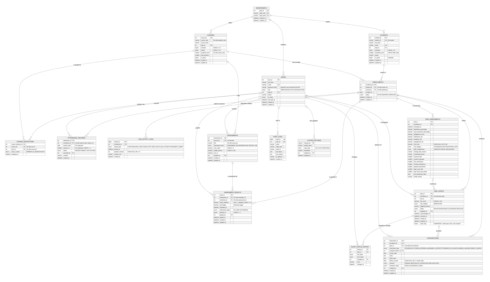

**Figure 4.2 — Entity–relationship diagram (sixteen tables)**

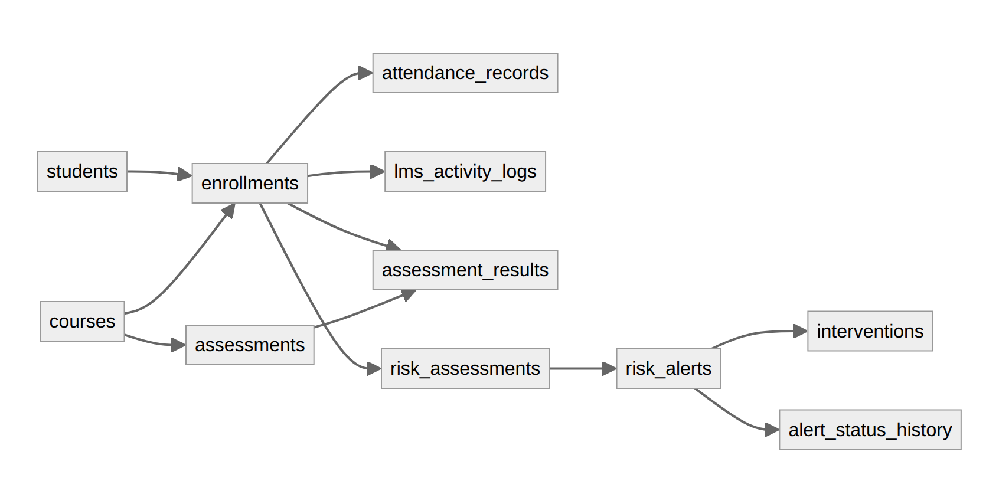

**Figure 4.3 — The engagement spine: every fact hangs off `enrollments`**

**The engagement spine.** Every engagement fact — attendance, activity,
results, risk, alerts, interventions — references `enrollment_id`. None
of them references a `(student_pk, course_pk)` pair.

An enrolment *is* a validated student–course pair. Routing every fact
through it means:

- A record for a student not enrolled on that course is structurally
  impossible, rather than prevented by a check somebody might forget.
- No fact table carries a transitive dependency on the student or the
  course, so third normal form holds without argument.
- A single join reaches both the student and the course from any fact.

### 4.3 Relational schema

Sixteen tables.

**Table 4.1 — The sixteen tables**

| # | Table | Purpose |
|---|---|---|
| 1 | `departments` | Reference table for students, courses and staff |
| 2 | `users` | Staff accounts; `role` drives access control |
| 3 | `students` | Student records; soft-deleted, never removed |
| 4 | `courses` | Course catalogue, unique per code and academic term |
| 5 | `course_instructors` | M:N between courses and staff |
| 6 | `enrollments` | M:N between students and courses — **the spine** |
| 7 | `attendance_records` | One row per enrolment per class session |
| 8 | `lms_activity_logs` | Raw engagement telemetry |
| 9 | `assessments` | Assignments, quizzes, examinations |
| 10 | `assessment_results` | Marks; `percentage` maintained by trigger |
| 11 | `risk_assessments` | Append-only risk history |
| 12 | `risk_alerts` | Early-warning alerts; at most one open per enrolment |
| 13 | `alert_status_history` | Immutable trail of status transitions |
| 14 | `interventions` | Counselling, tutoring and follow-up records |
| 15 | `system_settings` | The risk model's tunable parameters |
| 16 | `audit_logs` | Written by the application and by triggers |

Verified against `information_schema` on the loaded database: 16 tables,
12 views, 6 procedures, 3 functions, 12 triggers, 27 foreign keys, 14
`CHECK` constraints, 12 unique keys and 77 indexes.

### 4.4 Normalisation

The schema is in **third normal form**, in the sense of Codd's
relational model [9] as presented in the standard texts [10].

**Table 4.2 — Normal forms and how each is satisfied**

| Form | How it is satisfied |
|---|---|
| **1NF** | Every column holds one atomic value. No repeating groups and no delimited lists. Multi-valued facts — a student's many courses, a course's many instructors — are separate tables. |
| **2NF** | Every table has a single-column surrogate primary key, so no non-key attribute can depend on part of a key. The composite keys that exist are *unique constraints*, not primary keys. |
| **3NF** | No transitive dependencies. `attendance_records` stores `enrollment_id` and reaches the student and course by join rather than copying them. Department names live only in `departments`. |

**Two deliberate denormalisations.** An examiner expects a candidate to
defend a denormalisation rather than pretend none exists.

1. **`assessment_results.percentage`** is functionally dependent on
   `marks_obtained` and the parent assessment's `max_marks`, and is
   therefore redundant. It is stored because it is read far more often
   than written — every risk calculation and every report averages it —
   and because a stored column can be indexed. It cannot drift from its
   inputs: `trg_ar_before_insert` and `trg_ar_before_update` recompute
   it on every write, so the column is owned by the database and not by
   whichever client happened to insert the row.

2. **The whole of `risk_assessments`** is derived from attendance,
   results and activity. It exists because risk must be *trended over
   time*, and recomputing a historical score from today's rows would
   give today's answer rather than the answer that was acted on in week
   four. The supporting counters and `model_version` are snapshotted for
   the same reason: an old score must remain explicable with the data
   and the weights that produced it.

Both are documented rather than accidental, which is the distinction
that matters.

### 4.5 Constraints and keys

Referential integrity is explicit everywhere: all 27 foreign keys name
their `ON UPDATE` and `ON DELETE` behaviour rather than taking a
default. Reference data uses `RESTRICT` so a department in use cannot be
deleted; optional links use `SET NULL`; owned history uses `CASCADE`, so
deleting an alert removes its status history.

Composite unique keys encode the business rules:

**Table 4.3 — Constraints and what each prevents**

| Constraint | What it prevents |
|---|---|
| `uq_enrollment_student_course` | Enrolling the same student twice on one course |
| `uq_attendance_session` | Two attendance rows for one enrolment and session |
| `uq_result_assessment_enrollment` | Two marks for one student on one assessment |
| `uq_courses_code_term` | Two courses with one code in one term |
| `uq_assessment_course_title` | Two assessments with one title on a course |
| `uq_course_instructor` | Assigning the same instructor twice |
| `uq_alert_one_active_per_enrollment` | **A second open alert for one enrolment** |

**The design decision worth explaining in a viva.** The last of these is
the most interesting thing in the schema. The requirement is "at most
one *open* alert per enrolment, but any number of resolved ones", and a
plain unique key cannot express it — it would forbid the history.

The solution is a stored generated column:

```sql
active_flag TINYINT(1) GENERATED ALWAYS AS
    (CASE WHEN status = 'RESOLVED' THEN NULL ELSE 1 END) STORED,
UNIQUE KEY uq_alert_one_active_per_enrollment (enrollment_id, active_flag)
```

Every open alert has `active_flag = 1`, so two of them for one enrolment
collide on the unique key. A resolved alert has `active_flag = NULL`,
and a MySQL unique index permits repeated NULLs [7], so resolved
history is unlimited.

The duplicate-alert requirement is therefore satisfied by the storage
engine rather than by application logic. No amount of concurrency, no
retry, no second instance of the application and no direct `INSERT` can
produce two open alerts. Chapter 8 shows this holding under twenty
simultaneous threads.

### 4.6 Indexing strategy

Beyond primary and unique keys, indexes follow the access patterns:
filter columns on the list screens (`students.dept_id`,
`students.semester`, `courses.is_active`), the enrolment spine on every
fact table, and composite indexes where a query filters and orders on
the same pair.

The composite index worth discussing is `ix_lms_enrollment_time` on
`lms_activity_logs (enrollment_id, activity_at)`. The engagement
calculation asks for one enrolment's events within a date window, which
is exactly a leading-column equality followed by a range. `EXPLAIN`
shows it used as a range scan reading 26 rows out of 270,000.

---

## Chapter 5 — The risk model

### 5.1 The formula

```
Risk Score = 0.35 × Attendance Risk
           + 0.40 × Academic Risk
           + 0.25 × Engagement Risk
```

Each component is on a 0–100 scale where **higher means more at risk**:

```
Attendance Risk = 100 − Attendance Percentage
Academic Risk   = 100 − Average Assessment Percentage
Engagement Risk = 100 − Engagement Score
```

The result is clamped to 0–100 and rounded half-up to two decimals.
Academic performance carries the largest weight because it is the
outcome the system exists to protect; engagement carries the smallest
because it is the noisiest signal.

### 5.2 The three components

**Attendance percentage.** `100 × sessions_attended / sessions_held`,
with two deliberate rules:

- `PRESENT` and `LATE` both count as attended. A student who arrived
  late was in the room, and treating lateness as absence would double-
  penalise it, since lateness already affects the engagement component.
- `EXCUSED` is removed from **both** numerator and denominator. An
  authorised absence is not evidence of disengagement, and leaving it in
  the denominator would quietly punish a student for being ill with
  permission.

At least three recorded sessions are required before the component is
used.

**Average assessment percentage.** The mean of `percentage` over rows
where `marks_obtained IS NOT NULL`. A row that was not submitted, or was
submitted but not yet marked, is **excluded, never counted as a zero**.
At least one graded item is required.

This is the distinction between "we know this student scored badly" and
"we do not yet know how this student scored", and conflating them is the
most common way a system like this becomes unfair.

**Engagement score** (0–100, higher is better):

```
engagement = clamp(100 − (recency + frequency + missing + late), 0, 100)
```

**Table 5.1 — Engagement penalties**

| Penalty | Rule |
|---|---|
| **recency** — days since the last platform event | never active → 50 · ≤3 → 0 · ≤7 → 10 · ≤14 → 20 · ≤30 → 35 · >30 → 50 |
| **frequency** — logins in the window against a target of 12 | `logins ≥ target` → 0 · `logins×3 ≥ target×2` → 5 · `logins×3 ≥ target` → 12 · `logins ≥ 1` → 20 · none → 30 |
| **missing** | `40 × missing_submissions / results_recorded` |
| **late** | `20 × late_submissions / results_recorded` |

The frequency bands use integer cross-multiplication rather than a
floating-point ratio, for a reason given in §5.6.

### 5.3 Missing data, and why it is the part that matters

A component with no supporting data is **dropped**, and the remaining
weights are **re-normalised**:

```
risk = Σ(wᵢ × riskᵢ for available i) / Σ(wᵢ for available i)
```

The consequence is best shown by example. Consider a student four weeks
into a term with 80% attendance, flawless engagement, and no graded work
yet — a perfectly ordinary and perfectly fine student.

**Table 5.2 — Missing marks treated as zero versus dropped**

| | academic treated as zero (**wrong**) | academic component dropped (**this system**) |
|---|---|---|
| attendance risk 20 × 0.35 | 7.00 | 7.00 |
| academic risk **100** × 0.40 | 40.00 | — excluded |
| engagement risk 0 × 0.25 | 0.00 | 0.00 |
| available weight | 1.00 | 0.60 |
| **score** | **47.00 → MEDIUM RISK** | **11.67 → LOW RISK** |

Treating the absence of a grade as a zero would flag this student as at
risk purely for being early in the term, and would do so for most of the
cohort in week four — which is exactly when staff would learn to ignore
the system.

**Table 5.3 — Data completeness and banding**

| Components available | `data_completeness` | `risk_category` |
|---|---|---|
| 3 | `COMPLETE` | banded by score |
| 2 | `PARTIAL` | banded by score |
| 0 or 1 | `INSUFFICIENT` | **`INSUFFICIENT_DATA`** — no band |

With fewer than two observable components the score is still computed
and stored, but **no band is assigned and no alert is raised**. The
interface shows the reason instead of a band, and the demonstration
dataset deliberately contains four such enrolments so that the behaviour
is visible rather than theoretical.

### 5.4 Bands and thresholds

**Table 5.4 — Risk bands and thresholds**

| Band | Score | Setting |
|---|---|---|
| Low | 0–29 | — |
| Medium | 30–59 | `risk.threshold.medium` = 30 |
| High | 60–100 | `risk.threshold.high` = 60 |
| Needs more data | not banded | — |

The weights, the thresholds, the engagement penalties, the activity
window and the login target are rows in `system_settings`, read at
calculation time by `fn_setting_num`. They are configuration, not code,
for two reasons: a department may reasonably disagree about where
"medium" begins, and a score must remain explicable years later, which
is why each `risk_assessments` row stores the `model_version` that
produced it.

### 5.5 Alerts

An alert is raised when the band is `MEDIUM` or `HIGH` **and** the score
is at least `alert.min_score` (default 30).

**Table 5.5 — How alerts respond to each situation**

| Situation | What happens |
|---|---|
| At or above threshold, no open alert | **raise** a new alert with status `NEW` |
| At or above threshold, open alert exists | **refresh** its score and factors — never duplicate |
| Below threshold, open alert still `NEW` | **auto-resolve**; nobody had picked it up |
| Below threshold, alert acknowledged or in progress | **leave it alone**; a human owns it |

Status transitions:

```
NEW ──→ ACKNOWLEDGED ──→ IN_PROGRESS ──→ RESOLVED
 │            │                             ▲
 │            └─────────────────────────────┤
 └──────────────────────────────────────────┘
```

`RESOLVED` is terminal. A resolved alert is never reopened; if risk
rises again a *fresh* alert is raised. This keeps the history honest
about how many separate episodes there were, which matters when someone
later asks how often a student was flagged.

Alert generation is deliberately **not** done in a trigger. A trigger on
`risk_assessments` would fire during the recalculation cursor and make
the alert logic re-entrant and much harder to reason about; the
procedure raises alerts explicitly, inside the same transaction.

### 5.6 Keeping two implementations in step

The model is implemented twice: as `sp_recalculate_risk_for_enrollment`
in SQL, and as `risk_engine.py` in the application. This is a
requirement of the brief — the database must demonstrate stored
procedures — but two implementations of one formula are an invitation to
drift.

Three mechanisms prevent it.

1. **One written specification.** §5.1–5.5 of this chapter, mirrored in
   `docs/database_design.md` §3, is the single source. Neither
   implementation is the definition; both are implementations of it.
2. **Half-up rounding on both sides.** MySQL's `ROUND` is half-up.
   Python's built-in `round` is banker's rounding, which would differ on
   exact halves, so the engine uses
   `Decimal.quantize(..., ROUND_HALF_UP)`.
3. **Integer cross-multiplication at band boundaries.** With a login
   target of 12, exactly 8 logins is two-thirds. Written as
   `logins / target >= 0.667` the two implementations could disagree at
   that boundary on a floating-point representation. Written as
   `logins * 3 >= target * 2` the comparison is exact in both.

The agreement is tested rather than assumed. Every enrolment in the
demonstration database is scored by the stored procedure during seeding
and then recomputed by the Python engine, and all twenty stored fields
are compared: **80 enrolments × 20 fields = 1,600 comparisons, zero
mismatches.** `backend/scripts/check_risk_parity.py` makes the
comparison and can be re-run against any MySQL database.

The check also found a divergence that the demonstration settings hid.
The procedure reads every setting as `DECIMAL(10,4)` and converts
integer settings with `CAST(... AS SIGNED)`, which rounds; the engine
truncated. With a medium threshold of 24.5 and weights of 0.33335 and
0.41665, three enrolments disagreed — one placed LOW by SQL and MEDIUM
by Python. The engine now converts settings exactly as the procedure
does, the same run gives zero mismatches, and a unit test pins the
conversion.

### 5.7 Ethical considerations

A system that scores students needs its limits written down. Slade
and Prinsloo set out the ethical issues learning analytics raises —
transparency, informed consent, the student as an agent rather than a
passive subject of data, and the fact that a student's identity and
performance change over time, so that no score is final [11]. The
design responds to them as follows.

- **The score is an indicator, not a judgement.** It is stated in the
  sidebar of every page and in the footer of the risk detail page.
- **Nothing is hidden.** The detail page shows the formula, the weights,
  each component, the observed figures behind them, the contributing
  factors in words, and the penalty breakdown. A student shown this page
  can dispute a specific number.
- **Missing data is never evidence.** This is a design rule, not a
  nicety; §5.3 shows what the alternative would do.
- **No demographic input.** The model reads attendance, marks and
  activity. It does not read gender, nationality, age or background.
- **Visibility is restricted.** Scores are staff-only, and the role with
  the broadest read access — the Department Chair — holds no write
  permission at all.

A fairness audit across demographic groups is listed in Chapter 9 as
future work. It is the obvious next thing a deployment would need and it
has not been done here, because the demonstration data is synthetic and
auditing fiction would prove nothing.

---

## Chapter 6 — Implementation

### 6.1 Technology stack

**Table 6.1 — Technology stack**

| Layer | Choice | Why |
|---|---|---|
| Database | MySQL 8.0.16+ | Enforced `CHECK` constraints, CTEs and window functions [7] — all three are used, and none exists in MySQL 5.7. Stored generated columns are used too |
| Backend | FastAPI (Python) [12] | Request validation from type hints, dependency injection for the permission layer, and an OpenAPI document generated from the code rather than maintained beside it |
| ORM | SQLAlchemy 2.0 [13] | Core expressions for the aggregate queries, ORM for entities; parameterised by construction |
| Validation | Pydantic v2 | One schema serves validation, serialisation and documentation |
| Frontend | React 18 + Vite [14] | Component model suits a form-and-table application; Vite keeps the dev loop fast |
| Styling | Tailwind CSS | Consistent spacing and colour without a separate stylesheet to drift |
| Charts | Recharts | Declarative, composes with React, no imperative canvas code |
| Hashing | Argon2id | Current OWASP recommendation for password storage [15] |

### 6.2 Database implementation

**Views — twelve.** Four are building blocks that roll up one fact table
per enrolment; eight are composite views built on them.

**Table 6.2 — Views and the concepts they demonstrate**

| View | Concepts demonstrated |
|---|---|
| `v_enrollment_attendance` | `LEFT JOIN`, conditional aggregation, divide-by-zero guard |
| `v_enrollment_academics` | `AVG` over a filtered `CASE` |
| `v_enrollment_activity` | Date arithmetic — `INTERVAL`, `DATEDIFF` |
| `v_latest_risk` | **CTE + `ROW_NUMBER()` window function** |
| `student_performance_view` | Four-table join plus three `LEFT JOIN`s onto views |
| `course_attendance_summary` | `GROUP BY` with **`HAVING`** |
| `course_performance_summary` | `AVG`, `STDDEV_SAMP`, `NULLIF` guard |
| `v_submission_patterns` | `LEFT JOIN` so an assessment with no submissions still appears |
| `student_risk_summary` | A view built on another view |
| `department_risk_summary` | Aggregation over a view |
| `v_active_alerts` | **Correlated scalar subquery** in the select list |
| `v_intervention_outcomes` | Multi-table join plus `LEFT JOIN` to a view |

`v_latest_risk` is the one to show in the report, because
`risk_assessments` is append-only and "the current score" is therefore a
query rather than a column:

```sql
CREATE VIEW v_latest_risk AS
WITH ranked AS (
    SELECT ra.*,
           ROW_NUMBER() OVER (PARTITION BY ra.enrollment_id
                              ORDER BY ra.calculated_at DESC,
                                       ra.risk_id DESC) AS rn
    FROM risk_assessments ra
)
SELECT * FROM ranked WHERE rn = 1;
```

**Stored functions — three.** `fn_setting_num` reads a tunable
parameter with a fallback; `fn_engagement_score` implements §5.2;
`fn_risk_category` implements the banding including the
`INSUFFICIENT_DATA` case.

**Stored procedures — six.**
`sp_recalculate_risk_for_enrollment` scores one enrolment and reconciles
its alert; `sp_recalculate_all_risk` iterates with a **cursor**;
`sp_enroll_student`, `sp_record_attendance` and
`sp_upsert_assessment_result` perform guarded writes; and
`sp_update_alert_status` enforces the transition graph. Two of them
declare `EXIT HANDLER FOR SQLEXCEPTION`, and `SIGNAL SQLSTATE '45000'`
is used throughout to raise meaningful errors.

**Triggers — twelve**, in two groups.

*Validation (5).* `trg_ar_before_insert` and `trg_ar_before_update` own
`assessment_results.percentage` and the marks range check;
`trg_assess_before_insert` and `trg_assess_before_update` validate
assessments; `trg_intervention_before_insert` enforces a cross-row rule
that a foreign key cannot express — an intervention's alert must belong
to the same enrolment as the intervention.

*Audit (7).* One per significant table, writing to `audit_logs` using
the null-safe comparison operator `<=>` so that a change to or from
`NULL` is recorded rather than silently skipped.

Three design rules were followed: no trigger writes to its own table;
`audit_logs` itself has no triggers; and alert generation is not done in
a trigger, for the reason given in §5.5.

**The demonstration worth putting in the report** is the marks range
check, because it shows the layering. Entering 999 against an assessment
worth 10 is refused by the API — and would be refused again by the
database:

```sql
mysql> INSERT INTO assessment_results (enrollment_id, assessment_id, marks_obtained)
    -> VALUES (1, 1, 999);
ERROR 1644 (45000): assessment_results: marks_obtained exceeds max_marks
```

The upper bound has to be a trigger rather than a `CHECK` constraint,
because the limit lives in another table and a `CHECK` cannot read one.
The lower bound — a negative mark — *is* a `CHECK` constraint, since it
needs no other row.

**Transactions.** The recalculation run, alert status changes with their
history row, and bulk attendance and marks entry each run inside one
transaction. The pattern that matters is that a status change and its
`alert_status_history` row are written in the same transaction, so the
two can never disagree about what happened.

### 6.3 Analytical queries

`database/analytics_queries.sql` holds fifteen documented read-only
queries; all fifteen are reproduced with their output in Appendix C.
Six show the SQL concepts worth discussing:

**Table 6.3 — Selected analytical queries**

| Query | SQL concept |
|---|---|
| Q1 | Scalar subquery in the select list |
| Q5 | **Correlated subquery** — students below their own course's mean |
| Q6 | **CTE + `SUM() OVER ()`** — each department's share of all high-risk enrolments |
| Q11 | **`LAG()`** — each enrolment's change since its previous calculation |
| Q13 | `GROUP BY … HAVING` with **`GROUP_CONCAT`** |
| Q15 | **`EXPLAIN`** demonstration of index usage |

### 6.4 Backend

The application is layered: routers handle HTTP and permissions, a
services layer holds the risk engine and shared query builders, and the
ORM layer defines entities. Routers never build raw SQL and the services
layer never touches a request object.

**Authentication** is JWT with an expiry; the token carries the user id
and role, and the role is re-checked against the database row on every
request so that a revoked account cannot continue on an unexpired token.

**Authorisation** uses 24 named permissions (`students:read`,
`alerts:write`, …) mapped to the five roles in one dictionary, rather
than role checks scattered through the routers. An endpoint declares
what it needs:

```python
@router.post("", dependencies=[Depends(require_permissions(P_STUDENTS_WRITE))])
```

The Department Chair role holds **no** `:write` permission at all, which
is a property of the map rather than of any endpoint.

**Error handling** is centralised: domain exceptions map to status codes
and a single error envelope, so a client never receives an unhandled
stack trace, and messages stay safe — a failed login says that the
credentials were wrong, not which half.

### 6.5 Frontend

A React single-page application with routes guarded by permission, so a
user who types a URL they lack the rights for is redirected rather than
shown an empty page. Navigation is built from the permission list the
API returns at sign-in, which is why the same build shows a different
menu to each role.

Data fetching goes through one hook that models four states — loading,
error, empty and populated — so every screen handles all four rather
than only the happy path. Charts use a fixed status palette for risk
bands, always accompanied by an icon, a text label and the number, so
colour is never the only carrier of meaning; each chart has the same
figures available as a table.

### 6.6 Security

**Table 6.4 — Security measures**

| Measure | Implementation |
|---|---|
| Password storage | Argon2id, salted per password, rehashed on sign-in if parameters change |
| Credentials in transit | Exchanged once for a JWT with an expiry |
| Account enumeration | Unknown email and wrong password return the same 401 and cost the same Argon2 verification, so timing does not reveal which accounts exist |
| Password guessing | After 5 failed sign-ins for one email, or 20 from one address, within 15 minutes, further attempts get a 429 before any database or Argon2 work |
| Spreadsheet formulas in exports | A CSV cell starting with `=`, `+`, `-`, `@`, tab or CR is prefixed with `'`, so a name typed as a formula opens as text |
| Authorisation | Named permissions checked server-side on every endpoint |
| SQL injection | All access through SQLAlchemy with bound parameters; even sortable column names are checked against an allowlist rather than interpolated |
| Input validation | Pydantic on every body and query parameter, with `CHECK` constraints behind it |
| Secrets | Environment variables only; `.env` is git-ignored and `.env.example` ships placeholders. No key is built in: the server will not start with a missing, short or placeholder `SECRET_KEY` |
| Audit | `audit_logs`, written by the application and by seven triggers |
| Error messages | Centralised envelope; no stack traces, no credential hints |

Two properties were verified rather than asserted. No OpenAPI schema
exposes `password_hash`; and every data endpoint refuses an
unauthenticated request — sixteen were tried, all returned 401. Only
seven routes are public: the root, the login endpoint, the health check
and the four interactive documentation URLs.

---

## Chapter 7 — Testing

### 7.1 Strategy

Three levels, plus one that is easy to omit and was not.

- **Unit** — the risk engine against hand-computed figures; formatting
  helpers; chart components.
- **Integration** — every API endpoint through a real application
  instance against a real database, including the permission matrix.
- **End-to-end** — the running application driven in a real browser
  against MySQL, watching for console errors and failed requests.
- **Documentation** — a test that the API reference still describes the
  API that is served.

The reason for the fourth is that three defects in this project passed
their unit tests while being visibly broken, and one piece of
documentation drifted without anything failing. Tests that only exercise
the layer they were written for will miss both.

### 7.2 Backend tests — 526

**Table 7.1 — Backend test files**

| File | Tests | What it verifies |
|---|---|---|
| `test_auth.py` | 31 | Login, token expiry, password change, user management, failed-login throttling |
| `test_rbac.py` | 96 | The full permission matrix — every role against every guarded endpoint |
| `test_students.py` | 21 | CRUD, search, filters, soft delete, the profile view |
| `test_courses.py` | 17 | Catalogue, instructors, roster |
| `test_enrollments.py` | 16 | Enrolment rules, duplicate prevention, bulk enrolment |
| `test_attendance.py` | 16 | Marking, idempotent re-marking, excused handling |
| `test_assessments.py` | 26 | Assessments, marks entry, validation, trends |
| `test_risk_engine.py` | 48 | The formula, the bands, missing-data re-normalisation |
| `test_risk_api.py` | 20 | Recalculation, the table, the explanation payload |
| `test_alerts.py` | 30 | Generation, **duplicate prevention at the constraint**, transitions |
| `test_interventions.py` | 22 | Recording, alert linkage, date validation |
| `test_reports.py` | 36 | Report figures against hand-computed values, CSV export and its formula escaping, unscored profiles kept out of every mean |
| `test_system.py` | 36 | Health, settings, audit trail, error envelopes, an injection payload, the startup `SECRET_KEY` checks, database URL encoding |
| `test_seed.py` | 27 | Dataset properties, risk spread, reseed idempotency |
| `test_api_docs.py` | 76 | Every endpoint documented; every documented permission matches enforcement |
| `test_report_docs.py` | 8 | This report: appendices match their sources; figures, tables, citations and contents agree |
| **Total** | **526** | |

`test_api_docs.py` deserves a note. It reads the routes off the
application's own router table and the tables out of the API reference,
then asserts that every served endpoint has a row and that no row claims
a permission the code does not require. A permission column that
overstates the rule reads like a security guarantee while being fiction.

The test was itself tested, by deliberately breaking it twice: adding an
undocumented endpoint, and changing a documented permission from
`attendance:read` to `attendance:write`. Both were caught. A test that
cannot fail proves nothing.

### 7.3 Frontend tests — 92

Across formatting helpers (including that missing data renders as an em
dash and never as `0%`), the risk badge, the data table's four states
and server-side sorting, chart rendering, role-based navigation, the
data-fetching hook's state machine, the login page, the status-colour
helper and the trend chart.

### 7.4 Selected test cases

**Table 7.2 — Selected test cases**

| ID | Description | Input | Expected | Actual | Result |
|---|---|---|---|---|---|
| T1 | Formula produces the documented score | att 70%, acad 60%, eng 100 | 26.50, LOW | 26.50, LOW | Pass |
| T2 | A profile with no data is never high risk | no attendance, no marks, no activity | `INSUFFICIENT_DATA`, no alert | as expected | Pass |
| T3 | Dropping a component lowers the score | 80% attendance, no marks, perfect engagement | 11.67 LOW, not 47.00 MEDIUM | 11.67, LOW | Pass |
| T4 | Database refuses a second open alert | two open alerts, one enrolment | second `INSERT` rejected | duplicate-key error | Pass |
| T5 | A resolved alert cannot be reopened | `RESOLVED` → `IN_PROGRESS` | rejected | 422 with message | Pass |
| T6 | Marks above the maximum are rejected | 999 against max 10 | rejected by API and by trigger | 422; `SQLSTATE 45000` | Pass |
| T7 | A chair receives 403 on writes | chair → every write endpoint | 403 on all | 403 on all | Pass |
| T8 | Excused absence does not depress attendance | 10 sessions, 2 excused, 8 attended | 100% | 100% | Pass |
| T9 | A stored 0% survives to the profile | stored 0%, live 100% | 0% shown | 0% shown | Pass |
| T10 | SQL and Python agree | all 80 enrolments × 20 fields | zero mismatches | zero mismatches | Pass |

T9 is a regression test for a real defect found during this project, and
is described in §7.6.

### 7.5 Coverage

**93%** of backend statements: 3,678 statements, 270 uncovered.

What remains uncovered is concentrated in four modules, none of them the
model:

**Table 7.3 — Coverage by module**

| Module | Covered | What is missed |
|---|---|---|
| `app/api/activity.py` | 61% | Administrative paths the demonstration does not exercise |
| `app/api/auth.py` | 69% | Account-management branches |
| `app/db/session.py` | 74% | Connection setup |
| `app/core/exceptions.py` | 86% | Handlers reachable only by provoking a database failure mid-transaction |

The risk engine, which is the part whose correctness matters most, is
covered by 47 dedicated tests plus the SQL-agreement check of §5.6.

### 7.6 Defects found during testing

Four are worth reporting, because each illustrates a class of mistake.

**A falsy zero.** The student profile chose between a stored figure and
a live one with `stored or live`. In Python `0.0` is falsy, so a stored
**0% attendance** was treated as "no stored value" and replaced by the
live figure. A student recorded at 0% attendance — precisely the student
this system exists to catch — was shown **100%** attendance on their own
profile, disagreeing with their risk detail page. It was invisible in
the demonstration data, which contains no stored zero, so only a
deliberate test found it. T9 now guards it.

**Three defects that passed their unit tests.** A chart rendered no
segments because a Recharts vertical bar chart needs a category axis; a
primary key typed `BIGINT` did not auto-increment under SQLite because
only a plain `INTEGER PRIMARY KEY` is a rowid alias there; and a date
filter failed because MySQL's `CURRENT_TIMESTAMP` is local while
SQLite's is UTC. All three passed their tests while being broken, and
all three were found by running the application rather than testing it.

**Colour that contradicted the number.** The meters on the risk and
profile pages took a fixed colour — attendance always green, engagement
always amber. A student with 33.3% attendance and an engagement score of
9 out of 100 therefore got a reassuring green bar beside the number
saying they were in trouble. Status colours are reserved for status, so
they are now derived from the band the figure's own component risk falls
in.

**A legend for a line that could not exist.** The trend chart advertised
an "Attendance rate" series on the student profile, but the endpoint
behind that page returns assessment data only. The component now draws
the series the data actually contains.

---

## Chapter 8 — Results

### 8.1 The demonstration dataset

36 students, 6 courses, 4 departments, 11 staff, 80 enrolments, ~1,700
attendance records, ~5,400 activity events, 30 assessments and 380
results.

All identities are invented; no real student record is included. Dates
are written as `CURDATE()` arithmetic rather than fixed dates, so the
demonstration stays current whenever it is loaded. That carried a risk
of irreproducibility, which was checked: rebuilding the database from an
empty server reproduced **all 80 risk scores to the last decimal**, on
three separate occasions.

### 8.2 Screenshots

Figures 8.1–8.15 were captured from the running application against
MySQL, so the numbers agree across images. Longer captions for each are
in `docs/screenshots/README.md`.

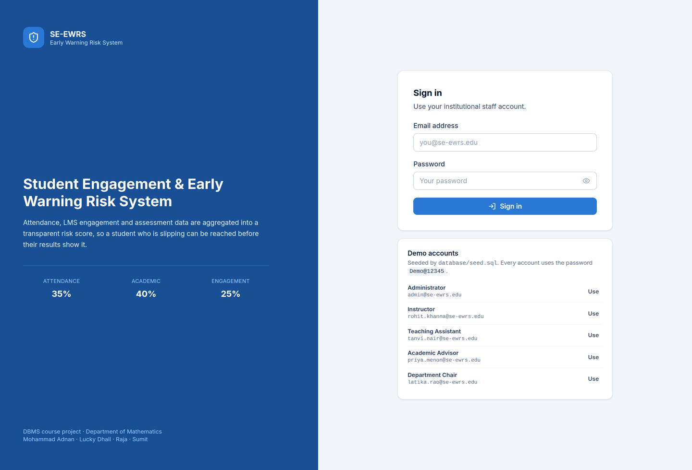

**Figure 8.1 — Login, with the demonstration accounts**

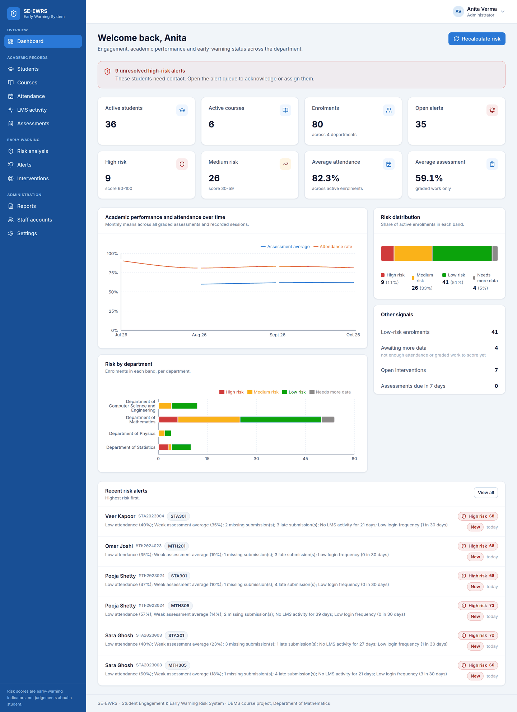

**Figure 8.2 — Administrator dashboard**

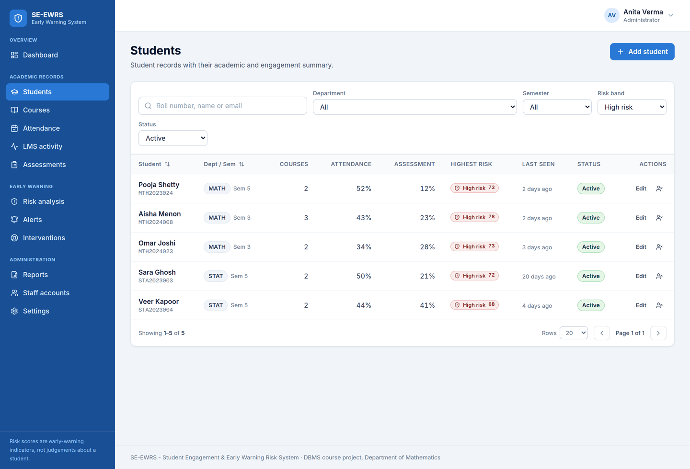

**Figure 8.3 — Students filtered to the high-risk band**

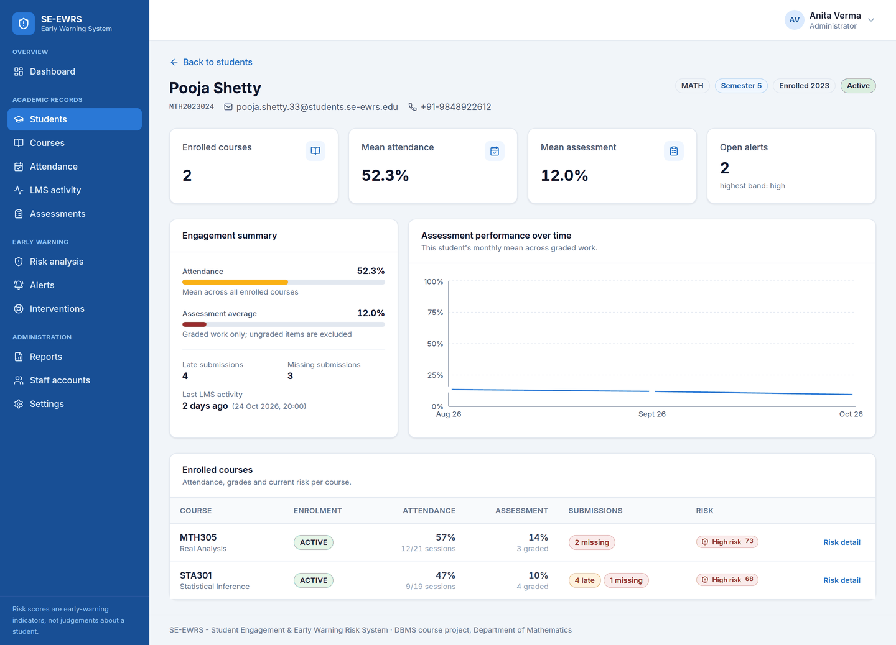

**Figure 8.4 — One student across all their courses**

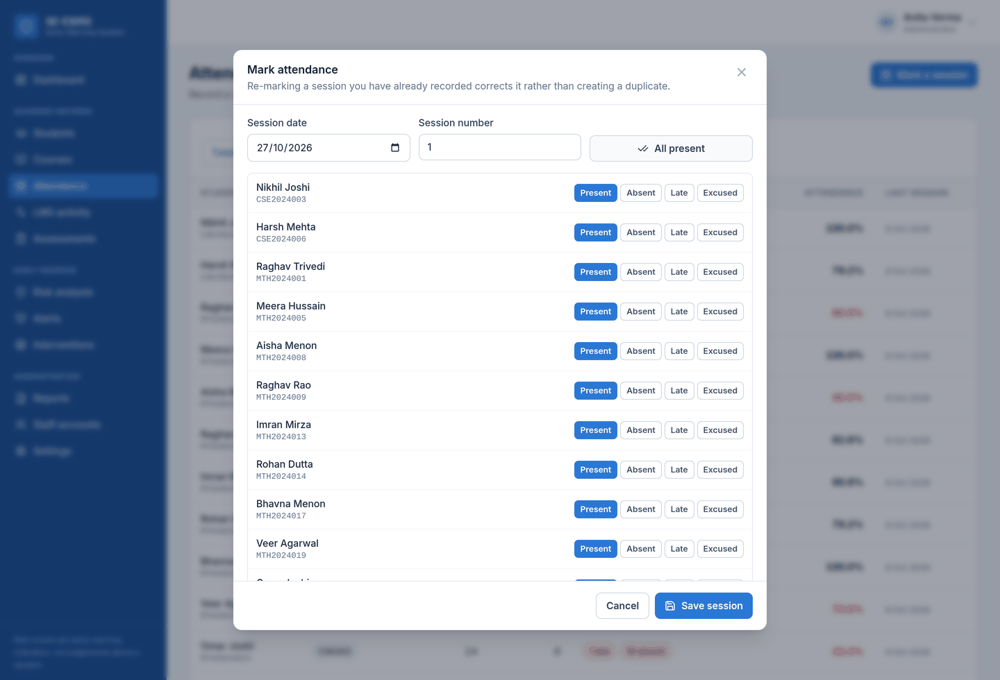

**Figure 8.5 — Marking a whole session's attendance**

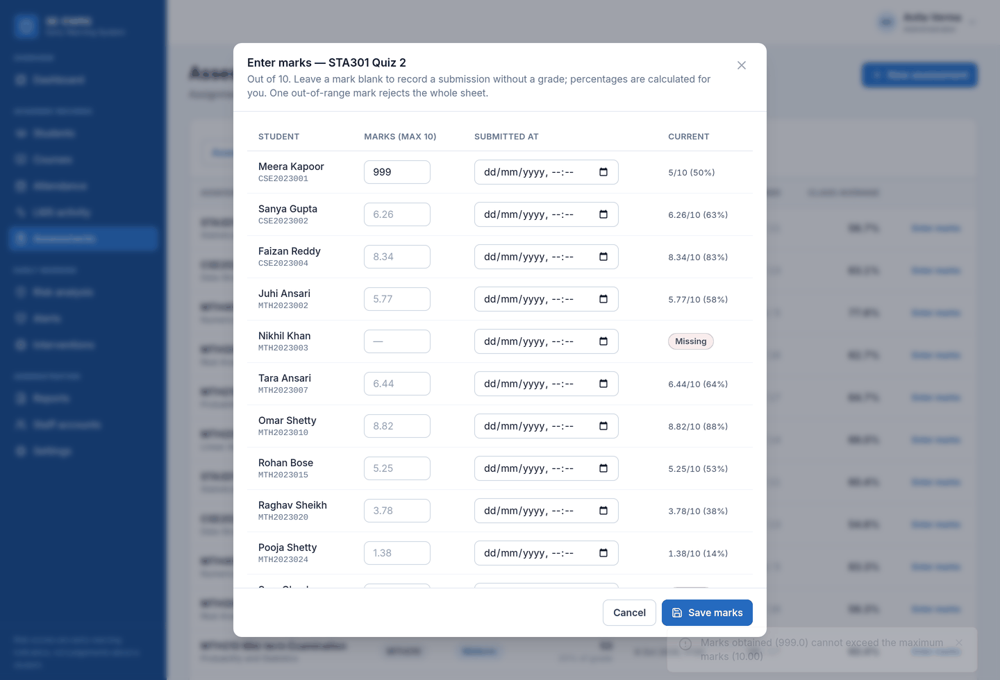

**Figure 8.6 — An out-of-range mark refused by the server**

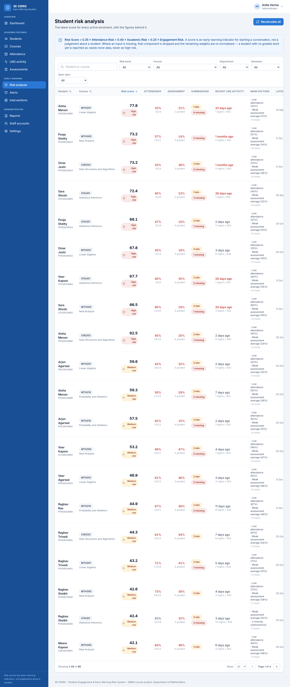

**Figure 8.7 — Risk analysis table**

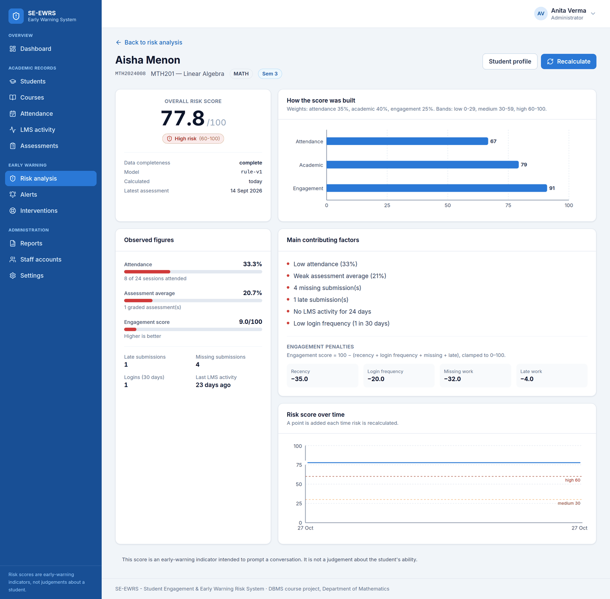

**Figure 8.8 — Risk detail for one enrolment**

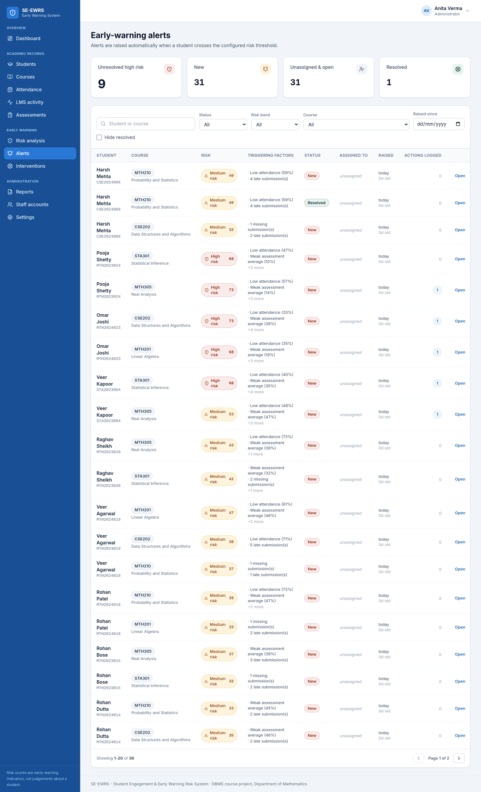

**Figure 8.9 — Early-warning alert queue**

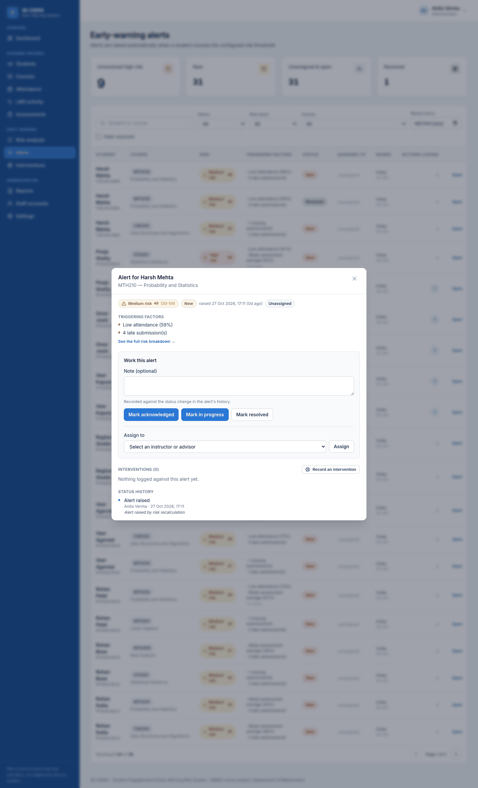

**Figure 8.10 — One alert with its status history**

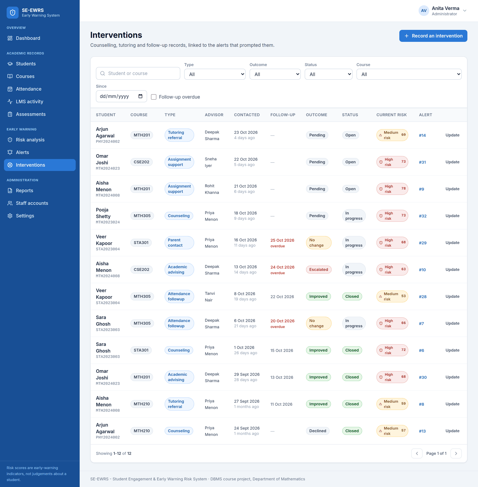

**Figure 8.11 — Intervention tracking**

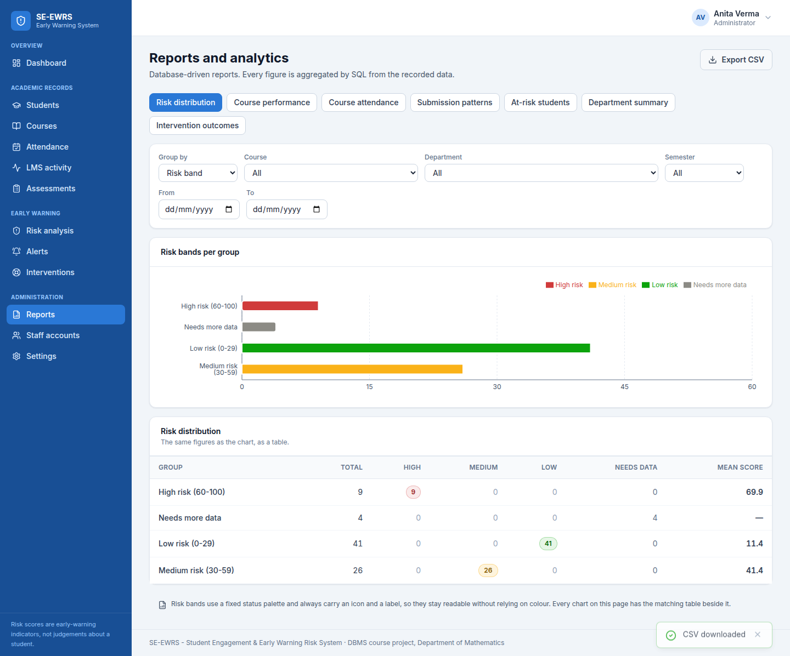

**Figure 8.12 — Reports, just after a CSV export**

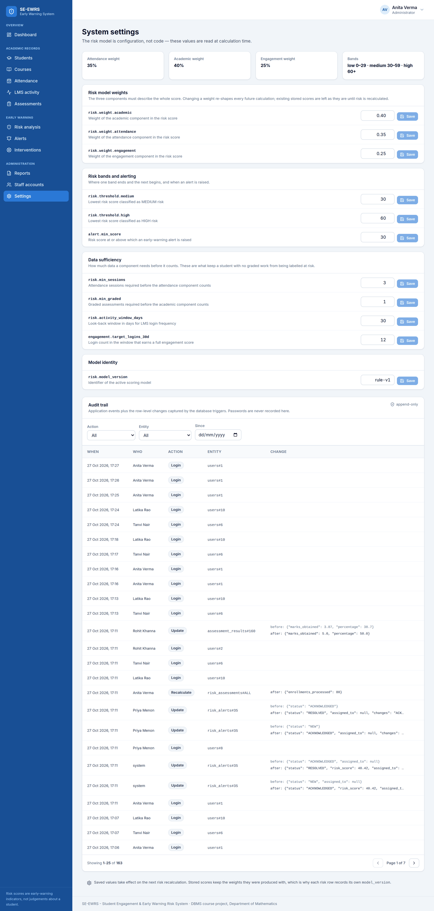

**Figure 8.13 — The configurable risk model**

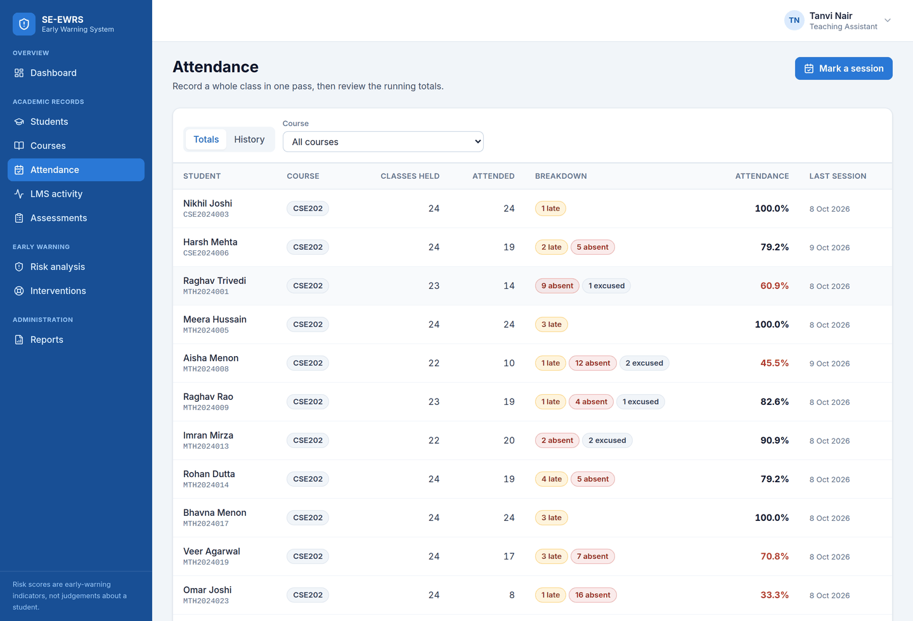

**Figure 8.14 — The application as a Teaching Assistant**

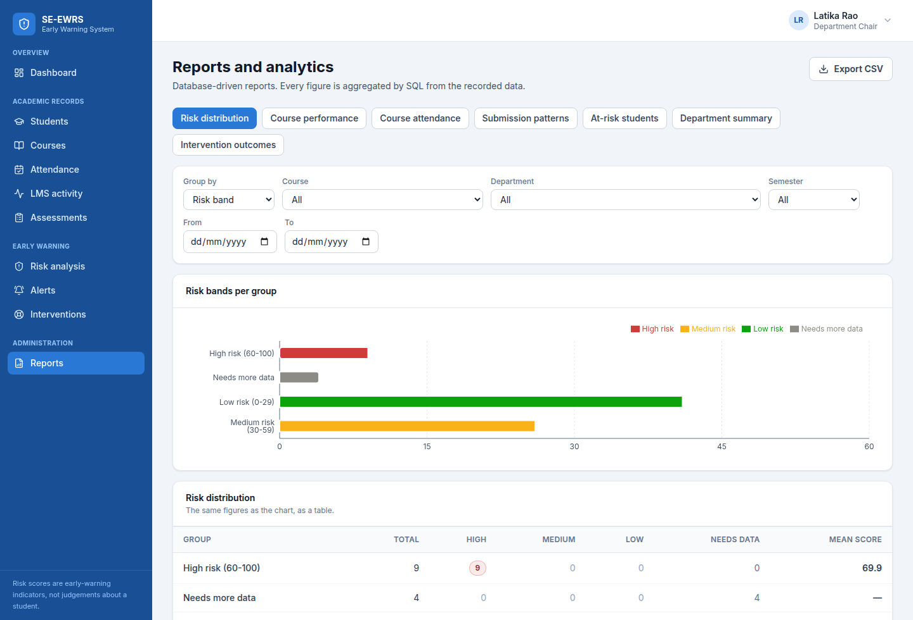

**Figure 8.15 — The application as a Department Chair**
Two deserve more than a caption.

**Figure 8.6 — marks validation.** A mark of 999 entered against an
assessment worth 10. The HTML `max` attribute does not stop it — that
attribute only constrains the spinner — so the request reaches the API,
which refuses it with *"Marks obtained (999.0) cannot exceed the maximum
marks (10.00)"*. The database would refuse it again. Three layers, and
the screenshot shows the one that actually matters. The same image also
shows a **Missing** badge, demonstrating that ungraded work is recorded
as missing rather than scored zero.

**Figures 8.14 and 8.15 — access control.** The same build and the same
URLs seen by a Teaching Assistant and by a Department Chair: different
navigation, different actions. The important point for the report is
that hiding a control is only the visible half — every endpoint behind
it re-checks the permission server-side, which `test_rbac.py` verifies
with 96 tests.

### 8.3 Observed risk distribution

**Table 8.1 — Observed risk distribution**

| Band | Enrolments | Share |
|---|---|---|
| Low (0–29) | 41 | 51% |
| Medium (30–59) | 26 | 33% |
| High (60–100) | 9 | 11% |
| Needs more data | 4 | 5% |

Thirty-five alerts are open across the cohort and twelve interventions
are recorded.

The shape is plausible for a real cohort: a majority coping, a
substantial middle group showing one or two warning signs, and a small
group in difficulty. A distribution with 60% high risk would indicate
thresholds set too low to be useful, and one with 2% would indicate a
system nobody would bother to check. The four unscored enrolments are
deliberate, and exist so that the missing-data path is visible in the
demonstration rather than only in the tests.

### 8.4 Performance

The system was stress-tested on a synthetic dataset **170 times** the
demonstration: 2,000 students, 60 courses, 6,000 enrolments and about
444,000 fact rows. This exposed three defects, all of the same kind.

**The access-path bug.** `sp_recalculate_risk_for_enrollment` read its
inputs with what looks like an efficient query — one row, filtered by
key:

```sql
SELECT ... FROM student_performance_view WHERE enrollment_id = ?
```

`EXPLAIN` shows why it is not. The plan contains `<derived3>`,
`<derived4>` and `<derived5>`: MySQL **materialises all three aggregate
sub-views in full and then filters**, so every call aggregated roughly
450,000 rows in order to fetch one.

**Table 8.2 — Risk recalculation before and after the procedure fix**

| | before | after |
|---|---|---|
| one enrolment | 4,406 ms | **33.5 ms** |
| all 6,000 | ~7 hours (projected) | **82 seconds** |

The fix reads the base tables with an `enrollment_id` predicate so the
per-enrolment indexes are used. Figure 8.16 is the plan of the old read,
captured from the 170× benchmark database built by
`database/scale_test.sh`.

```text
+----+-------------+------------+-------+--------------------------+------+-------------+
| id | select_type | table      | type  | key                      | rows | Extra       |
+----+-------------+------------+-------+--------------------------+------+-------------+
| 1  | PRIMARY     | e          | const | PRIMARY                  | 1    | NULL        |
| 1  | PRIMARY     | s          | const | PRIMARY                  | 1    | NULL        |
| 1  | PRIMARY     | d          | const | PRIMARY                  | 1    | NULL        |
| 1  | PRIMARY     | c          | const | PRIMARY                  | 1    | NULL        |
| 1  | PRIMARY     | <derived3> | ref   | <auto_key0>              | 10   | NULL        |
| 1  | PRIMARY     | <derived4> | ref   | <auto_key0>              | 10   | NULL        |
| 1  | PRIMARY     | <derived5> | ref   | <auto_key0>              | 10   | NULL        |
| 5  | DERIVED     | e          | index | PRIMARY                  | 6000 | Using index |
| 5  | DERIVED     | l          | ref   | ix_lms_enrollment_time   | 43   | NULL        |
| 4  | DERIVED     | e          | index | PRIMARY                  | 6000 | Using index |
| 4  | DERIVED     | r          | ref   | ix_results_enrollment    | 5    | NULL        |
| 3  | DERIVED     | e          | index | PRIMARY                  | 6000 | Using index |
| 3  | DERIVED     | a          | ref   | ix_attendance_enrollment | 23   | NULL        |
+----+-------------+------------+-------+--------------------------+------+-------------+
```

**Figure 8.16 — `EXPLAIN SELECT * FROM student_performance_view WHERE enrollment_id = 1` at 170× scale**

Columns `partitions`, `possible_keys`, `key_len`, `ref` and `filtered`
are omitted for width; the full output is in
`docs/analytics_output/slow_read_explain.txt`. Each `DERIVED` block
begins with an index scan of all 6,000 enrolments: the aggregate is
built for every enrolment, then the outer query keeps one. `EXPLAIN
ANALYZE` on the same statement reported 4,555 ms for the single row
returned, and inner lookups of 24, 5 and 45 rows per enrolment over
6,000 loops — 144,000 attendance, 30,000 result and 270,000 activity
rows, 444,000 in all. The fixed procedure took 20–38 ms per enrolment
on the same database, and a full recalculation 81 seconds.

**The same bug in the application.** The identical mistake existed in
Python, and cost a *page* rather than a batch job: endpoints that wanted
one enrolment filtered the *result* of a whole-table aggregate instead
of restricting the aggregate. Opening one student's profile took 3.4
seconds.

**Table 8.3 — Single-entity endpoints before and after**

| Endpoint | Before | After | |
|---|---|---|---|
| `GET /api/students/{pk}/profile` | 3,377 ms | **81 ms** | 42× |
| `GET /api/risk-assessments/{id}` | 3,725 ms | **79 ms** | 47× |
| `GET /api/courses/{pk}/roster` | 3,381 ms | **160 ms** | 21× |
| `GET /api/alerts/{id}` | 3,496 ms | **61 ms** | 57× |

That the same error appeared independently in SQL and in Python is the
point worth making: it is a way of thinking about queries — "filter the
answer" instead of "restrict the question" — rather than a typo.

**The paginated lists**, the subtlest of the three. A list computes its
aggregates over the whole filtered set to return a page of twenty, and
it cannot simply restrict them to the page, because the page is not
known until the query has run.

It does not need to. Reading what each endpoint actually *selects* by:

**Table 8.4 — What the paginated lists filter on versus what the aggregates supply**

| | filters, sorts and counts on | the heavy aggregates supply |
|---|---|---|
| `GET /api/risk-assessments` | enrolment, student, course, latest risk, open alert | three display columns |
| `GET /api/students` | student columns, risk counts | five display columns |

Neither list is *chosen* by the expensive aggregates. Each now selects
its page without them and computes them for the twenty rows returned.

**Table 8.5 — Paginated lists before and after**

| Endpoint | Before | After | |
|---|---|---|---|
| `GET /api/students` | 7,661 ms | **643 ms** | 12× |
| `GET /api/risk-assessments` | 7,852 ms | **777 ms** | 10× |

The fix came from reading what each endpoint filters and sorts on, not
from tuning anything.

**Proving the fixes changed nothing but speed.** An optimisation that
alters output is a defect. Each was checked rather than argued:

**Table 8.6 — Evidence that each optimisation left output unchanged**

| Fix | Evidence |
|---|---|
| Stored procedure | Both versions scored the same 80 enrolments; every field matched, including the generated factor text |
| Single-entity reads | 157 API responses — every risk detail, profile, roster and alert in the database — captured before and after; byte-identical |
| Paginated lists | 77 responses — five sort columns in both directions over multiple pages, every band, eight filter combinations, two empty results; byte-identical |

For the list fix there was also a static proof: with the optimisation
disabled the compiled SQL is unchanged, so the callers that share those
query builders provably did not move.

**Index usage.** `EXPLAIN` on the engagement window query shows
`ix_lms_enrollment_time` used as a range scan reading 26 rows out of
270,000 — a leading-column equality followed by a range, which is what
the composite index was designed for.

**Reproducibility.** None of this needs to be taken on trust. One
command rebuilds the benchmark database from the project's own schema,
generates the 444,000 rows, recalculates every enrolment and prints the
timings:

```bash
./database/scale_test.sh
```

It writes to `se_ewrs_scale` and refuses to run against the demonstration
database. A full build takes about two minutes, of which roughly 70
seconds is scoring 6,000 enrolments — the same run that was a projected
seven hours before the first fix.

### 8.5 Concurrency

The duplicate-alert guard was tested under real contention: threads
released from a barrier so they fire together against MySQL.

**Table 8.7 — Concurrency tests**

| Race | Result |
|---|---|
| 20 threads insert an open alert for one enrolment | **1 succeeded, 19 refused** by the unique key; exactly one open alert |
| 16 threads call the recalculation procedure on a high-risk student | all 16 completed, **exactly one alert**, no deadlocks |
| 12 threads enrol the same student on the same course | **1 enrolled, 11 refused** |

The second is the realistic one: two members of staff pressing
**Recalculate** at the same moment. A full run over the 6,000 enrolments
that `./database/scale_test.sh` generates raises **1,748 alerts, with
zero enrolments holding two**.

This is the evidence for the claim in §4.5. It is the constraint, not
the application code, that makes duplicates impossible — which is why
the guarantee survives concurrency, retries, a second instance of the
application, and a direct `INSERT`.

---

## Chapter 9 — Conclusion and future work

### 9.1 What was achieved

Against the objectives of §1.3:

1. **A normalised schema.** Sixteen tables in third normal form, with
   two deliberate denormalisations defended in §4.4. Invalid states are
   structurally impossible rather than discouraged: 27 foreign keys, 14
   `CHECK` constraints, 12 unique keys and 12 triggers.
2. **A transparent, configurable risk model.** Three weighted
   components, published weights, every figure behind a score visible on
   the detail page, and every parameter a row in `system_settings`
   rather than a literal in code.
3. **Alerts without duplicates.** Guaranteed by a unique key over a
   generated column, and demonstrated to hold under twenty concurrent
   threads.
4. **Intervention tracking**, linked to alerts with a cross-row rule
   that a foreign key cannot express, enforced by trigger.
5. **Role-based access for five roles**, enforced server-side and
   verified by 96 permission tests and by sixteen unauthenticated
   requests, all refused.

### 9.2 What was learned

**A view is an abstraction, not an index.** Reading one row from an
aggregate view looks like a cheap query and is not. The same mistake was
made independently in SQL and in Python, which suggests it is a habit of
thought rather than an accident.

**Constraints beat code for invariants.** Every attempt to prevent
duplicate alerts in application logic would have had a race condition.
One generated column and one unique key removed the entire class of
problem, and the proof is that twenty threads cannot break it.

**Missing data is not evidence.** The single most consequential design
decision in the model is that an absent component is dropped rather than
zeroed. §5.3 shows the same student scoring 47 or 11.67 depending on
that one choice.

**Tests confirm what they were written to confirm.** Three defects
passed their unit tests while being plainly broken in the browser, and a
piece of documentation drifted without anything failing. Running the
system, and testing the documentation, found what unit tests could not.

**Verify, do not assert.** Several figures in early drafts of this
report were wrong until measured — an apparent 25% performance
regression that was machine noise, a foreign-key count two short, a test
count one short. Each was caught by checking rather than by re-reading.

### 9.3 Limitations

- **The model is rule-based**, not learned from outcomes. It is
  transparent and contestable, but no claim is made that its weights are
  optimal, because there is no labelled data here against which optimal
  could be defined.
- **No live LMS integration.** Activity data is seeded; a deployment
  would need an importer.
- **One institution, synthetic data.** The thresholds are plausible, not
  calibrated.
- **No incremental recalculation.** A run re-scores every active
  enrolment rather than only those whose underlying data changed. At
  6,000 enrolments this is about 80 seconds, which is acceptable for a nightly
  job and wasteful for a continuous one.
- **No fairness audit.** See §5.7.
- **Permissions are per role, not per course.** An instructor may enter
  marks on any course, not only the ones they teach, and a chair reads
  every department. `course_instructors` records who teaches what, but
  no endpoint consults it. Scoping by course and department is the
  first change a real deployment would need.
- **Sessions are not revoked on a password change.** A token already
  issued stays valid until it expires (eight hours). Deactivating an
  account does end it immediately.
- **The token is kept in `localStorage`**, so a cross-site scripting
  flaw anywhere in the frontend could read it. No such flaw is known;
  the frontend never injects raw HTML.
- **Failed sign-ins are counted in one process's memory.** That suits
  the single uvicorn worker used here; several workers would each keep
  their own count and need a shared store such as Redis.

### 9.4 Future work

**Table 9.1 — Future work**

| Direction | Why it matters |
|---|---|
| Incremental recalculation | Score only enrolments whose facts changed since the last run |
| Statistical or ML scoring | Validated against real outcomes, with the rule-based score kept as the explanation |
| Live LMS integration | Replace the seeded activity table with an importer |
| Notifications | Push an alert to an advisor rather than waiting for them to open the queue |
| A student-facing view | Showing a student their own engagement, which changes the system from surveillance to feedback |
| Fairness auditing | Check score distributions across demographic groups before any real deployment |

Of these, the student-facing view is the one that would most change the
character of the system. A score computed about a student and shown only
to staff is surveillance; the same score shown to the student, with the
same explanation, is feedback. The design supports it — the detail page
is already built to be read by somebody who may disagree with it — but
making that change responsibly needs the fairness audit first.

---

## References

[1] G. Siemens and P. Long, "Penetrating the fog: Analytics in learning and education," *EDUCAUSE Review*, vol. 46, no. 5, pp. 30–40, 2011.

[2] R. Balfanz, L. Herzog, and D. J. Mac Iver, "Preventing student disengagement and keeping students on the graduation path in urban middle-grades schools: Early identification and effective interventions," *Educational Psychologist*, vol. 42, no. 4, pp. 223–235, 2007.

[3] L. P. Macfadyen and S. Dawson, "Mining LMS data to develop an 'early warning system' for educators: A proof of concept," *Computers & Education*, vol. 54, no. 2, pp. 588–599, 2010.

[4] K. E. Arnold and M. D. Pistilli, "Course Signals at Purdue: Using learning analytics to increase student success," in *Proc. 2nd Int. Conf. Learning Analytics and Knowledge (LAK '12)*, Vancouver, BC, Canada, 2012, pp. 267–270.

[5] S. M. Jayaprakash, E. W. Moody, E. J. M. Lauría, J. R. Regan, and J. D. Baron, "Early alert of academically at-risk students: An open source analytics initiative," *Journal of Learning Analytics*, vol. 1, no. 1, pp. 6–47, 2014.

[6] C. Rudin, "Stop explaining black box machine learning models for high stakes decisions and use interpretable models instead," *Nature Machine Intelligence*, vol. 1, no. 5, pp. 206–215, 2019.

[7] Oracle Corporation, *MySQL 8.0 Reference Manual*. [Online]. Available: https://dev.mysql.com/doc/refman/8.0/en/

[8] P. P.-S. Chen, "The entity-relationship model — Toward a unified view of data," *ACM Transactions on Database Systems*, vol. 1, no. 1, pp. 9–36, 1976.

[9] E. F. Codd, "A relational model of data for large shared data banks," *Communications of the ACM*, vol. 13, no. 6, pp. 377–387, 1970.

[10] A. Silberschatz, H. F. Korth, and S. Sudarshan, *Database System Concepts*, 7th ed. New York, NY, USA: McGraw-Hill, 2019.

[11] S. Slade and P. Prinsloo, "Learning analytics: Ethical issues and dilemmas," *American Behavioral Scientist*, vol. 57, no. 10, pp. 1510–1529, 2013.

[12] S. Ramírez, *FastAPI documentation*. [Online]. Available: https://fastapi.tiangolo.com/

[13] *SQLAlchemy 2.0 documentation*. [Online]. Available: https://docs.sqlalchemy.org/en/20/

[14] *React documentation*. [Online]. Available: https://react.dev/

[15] OWASP Foundation, "Password Storage Cheat Sheet," *OWASP Cheat Sheet Series*. [Online]. Available: https://cheatsheetseries.owasp.org/cheatsheets/Password_Storage_Cheat_Sheet.html

---

## Appendices

The appendices are in [`report_appendices.md`](report_appendices.md),
generated from the source files by `docs/build_appendices.py` so they
cannot drift from the code they reproduce.

- **Appendix A** — Schema (`database/schema.sql`)
- **Appendix B** — Views, procedures and triggers
- **Appendix C** — The fifteen analytical queries, each with its output
- **Appendix D** — API endpoints (`docs/api_documentation.md` §4)
- **Appendix E** — Selected source listings: the Python risk model,
  alert reconciliation and the permission check
